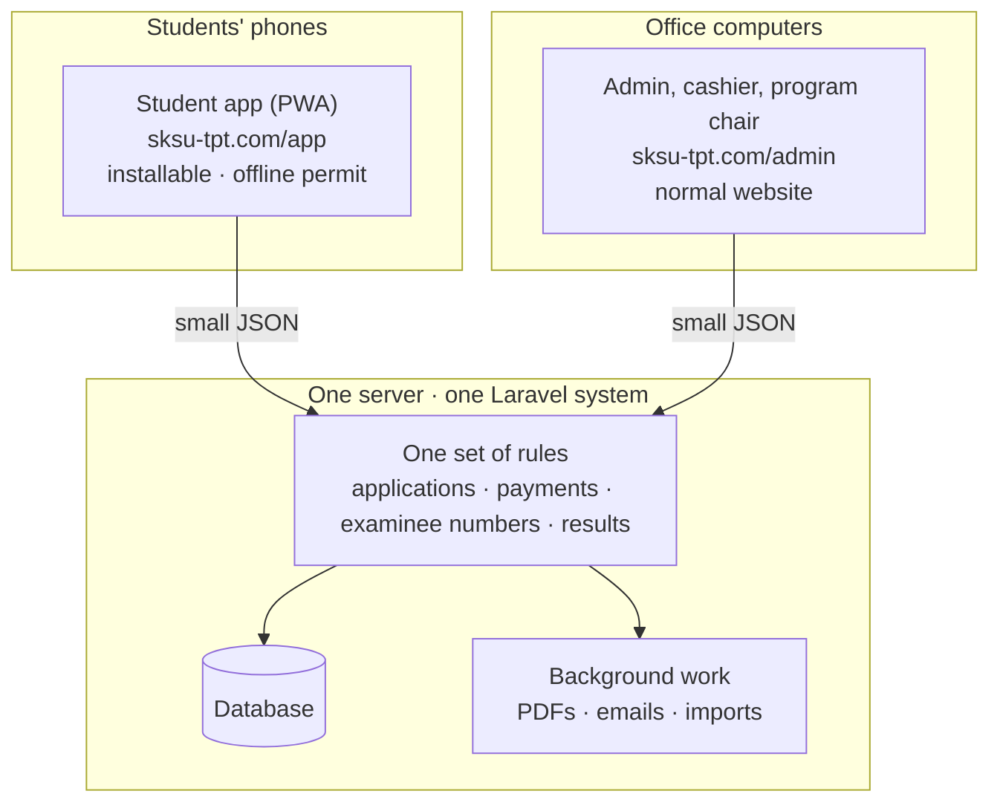
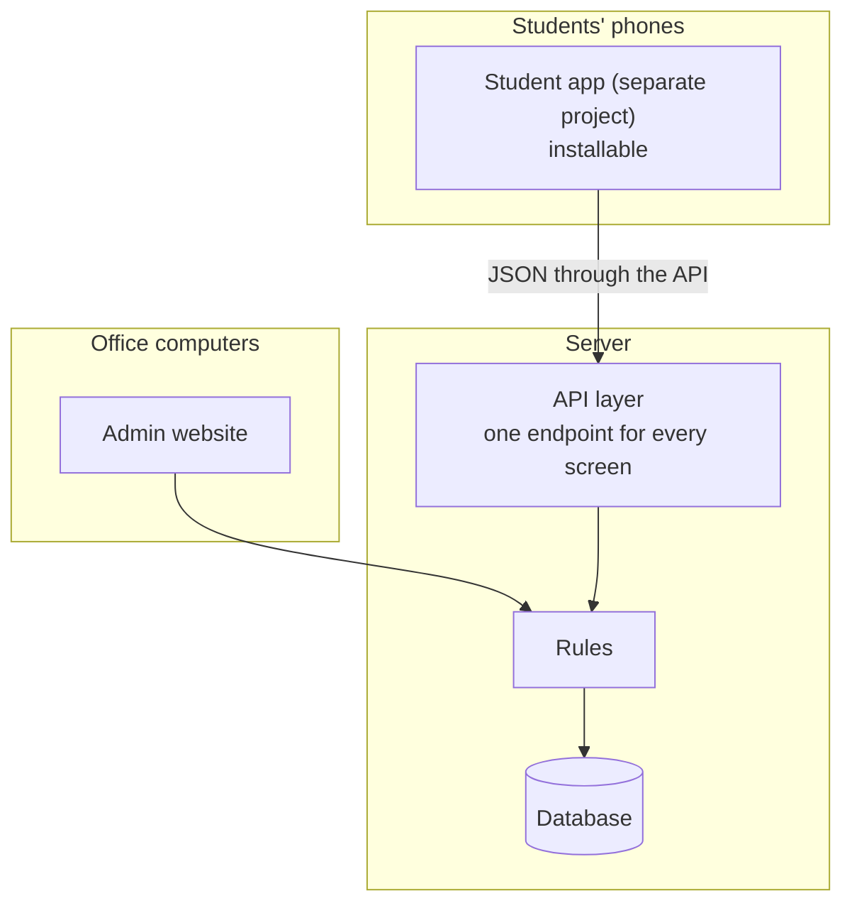

# How the system is put together

Two ways to build SKSU TPT v4. Both are fast for students, because the phone and the server only exchange small pieces of data (JSON). The difference is how many separate projects the team has to build and keep in step.

## Option A (recommended): one system, two parts

- The **student app** and the **admin** are separate to the people using them: different addresses, different look. Only the student part installs on phones.
- Behind them is **one system**, so a rule (for example "an OR number can be used once") lives in one place.
- **One project to build, one to update, one to deploy.**

## Option B: separate student app + API

- The student app is its **own project**. It talks to the server only through an **API** that the team must design, secure and keep in step with the app.
- Needed when there are **real store apps** (like euphoria's kiosk and scanner apps). TPT doesn't have those.

## Side by side

| | A. One system, two parts | B. Separate app + API |
|---|---|---|
| Speed for students | Fast (small JSON) | Fast (small JSON) |
| Projects to maintain | **1** | 2 |
| Build time | **Shorter** | Longer (every screen needs an API too) |
| Rules in one place | **Yes** | Split between API and app |
| Student app installs on phones | Yes (`/app` only) | Yes |
| Admin installs on phones | No (normal website) | No |
| Later store apps | Add an API then | Already there |

## What happens when a student opens Home (Option A)

| Step | Where | What happens |
|---|---|---|
| 1 | Phone | The app opens instantly: its screens are already saved on the phone |
| 2 | Phone → server | A tiny request: "Maria's status?" |
| 3 | Server | Reads it from the cache (no heavy database work) |
| 4 | Server → phone | A small answer, a few KB: *Exam slot picked · Isulan · Mar 14* |
| 5 | Phone | Shows Home with her next step and permit |

The first visit downloads the app once (about 1 to 2 MB). After that, every screen opens from the phone and only the student's own data travels, which is why it stays fast even with thousands of students.

## Recommendation

**Option A.** Students get a real installable app at `/app`, the office gets the admin at `/admin`, and the team builds and keeps **one** system. If SKSU later wants store apps, an API can be added without rebuilding.
