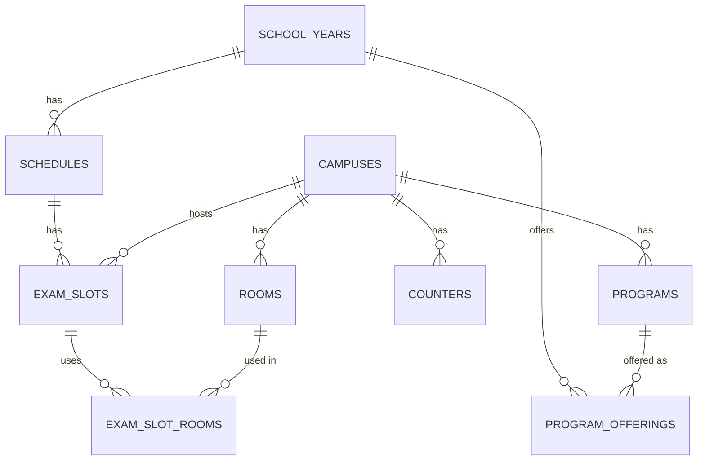
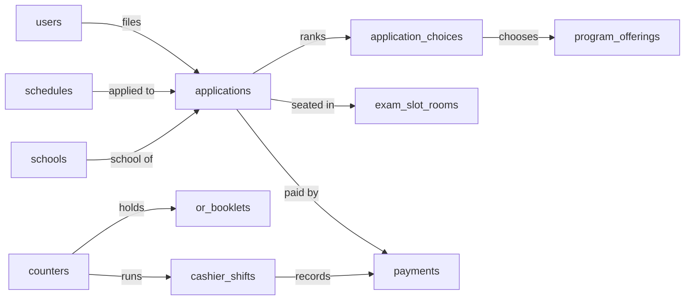
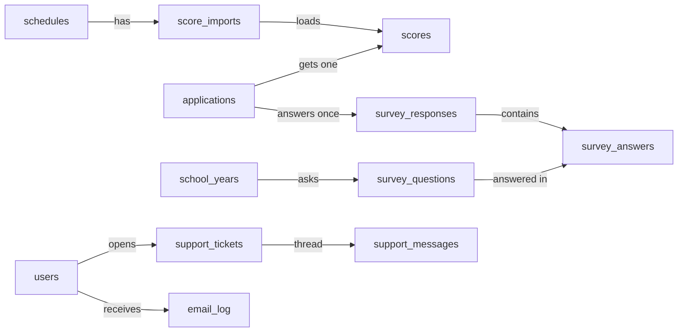

# Database design

The blueprint for SKSU TPT v4's database. It stores only what the screens and rules need. Every table says **which screens use it**, and every index says **which search or list it makes fast**.

## In short (for the office)

- **26 tables of our own**, plus the standard tables that Laravel and the packages bring (roles, files, activity log, settings, queue).
- **Each fact is stored once.** Things that can be worked out are worked out, not saved twice: who qualifies, the permit, counts.
- **Nothing is deleted** that already has applicants. Old school years become **read-only** archives.
- **Every staff change** (corrections, voids, moves, hides) is kept in the activity log with who, when, the old value and the new value.
- **The busy days stay fast:** the lists people search are indexed, the student's own data is cached, and result PDFs are built before release.

## 1. Principles

1. **Only what a screen or rule uses.** No "maybe later" columns.
2. **One fact, one place.** Example: an application's exam slot, room and seat live on the application itself (one per student), not in a separate table.
3. **Derived, not stored.** Qualification (score vs cut-off), the permit, seat counts on the dashboard and every "N waiting" badge are computed or cached.
4. **Indexes only for real queries.** Each index below names the screen it serves. Every foreign key is indexed.
5. **Rules the database can guarantee, it guarantees:** unique OR numbers, unique examinee numbers per school year, one seat per person, one application per student per schedule.
6. **Times are stored in UTC and shown in Philippine time (Asia/Manila).** Exam days are plain dates.
7. **Money is stored in centavos** (whole numbers), never as decimals.
8. **Packages do the standard parts:** roles (spatie/laravel-permission), files (spatie/laravel-medialibrary), activity log (spatie/laravel-activitylog), settings (spatie/laravel-settings), notifications, queue, cache and sessions (Laravel).

## 2. How the tables connect

### Setting up a school year

### Applying, paying and the exam

### Results, survey and support

## 3. Tables

Types: `id` = big integer key; `fk` = foreign key (indexed); `ts` = timestamp (UTC); every table also has `created_at` and `updated_at` unless noted.

### Setup

**school_years**: Exam schedules (school years tab), New school year, Edit school year.

| Column | Type | Null | Note |
|---|---|---|---|
| name | string(9) | no | "2027–2028"; unique |
| fee_centavos | int | no | ₱275.00 = 27500 |
| examinee_prefix | string(4) | yes | optional, e.g. "27-" |
| examinee_digits | tinyint | no | 5–8, default 6 |
| examinee_start | int | no | e.g. 600001 |
| examinee_next | int | no | the next number to give; only moves forward |
| examinee_locked_at | ts | yes | set when the first number is given; pattern can't change after |
| online_payment | bool | no | the switch; off by default |
| is_current | bool | no | the school year shown by default |
| archived_at | ts | yes | read-only from then on |

Unique: `name`. Index: `is_current` (every screen loads the current year).

**campuses**: Campuses and programs, filters everywhere. `name`, `short_name`, `address`, `is_active`. Unique: `name`.

**programs**: Campuses and programs. `campus_id` fk, `college` string (for deans), `name`, `short_name`, `is_board` bool, `is_active`. Unique: (`campus_id`, `name`). Index: (`college`) for the dean's program list.

**program_offerings**: what is offered in a school year, with its cut-off. Programs picker, results, chair page.

| Column | Type | Null | Note |
|---|---|---|---|
| school_year_id | fk | no | |
| program_id | fk | no | |
| cutoff | smallint | no | e.g. 530 |
| cutoff_basis | enum(overall, esm) | no | tptv3's ESM rule per program |
| transferee_slots | smallint | yes | only for programs that take transferees |

Unique: (`school_year_id`, `program_id`). A program not offered has no row.

**rooms**: Rooms page, exam slot room picker. `campus_id` fk, `building`, `name`, `seats` smallint, `is_active`. Unique: (`campus_id`, `building`, `name`).

**schedules**: Exam schedules, the schedule picker on every page, the landing page.

| Column | Type | Null | Note |
|---|---|---|---|
| school_year_id | fk | no | |
| number | tinyint | no | 1, 2, 3, 4… |
| type | enum(freshmen, transferees) | no | |
| registration_opens_at / registration_closes_at | ts | no | closes 11:59 PM Philippine time, stored in UTC |
| pay_by_at | ts | no | after registration closes |
| change_slot_until | ts | yes | "change your exam slot once until …" |
| report_time / start_time | time | no | default guide times for its exam slots |
| checkin_enabled | bool | no | off by default |
| published_at | ts | yes | null = not public |
| results_release_at | ts | yes | planned release |
| results_published_at | ts | yes | when students could first see results |
| results_hidden_at | ts | yes | the "Visible to students" toggle off |
| release_plan | json | yes | waves size and interval, PDF option |

Unique: (`school_year_id`, `number`). Index: (`published_at`, `registration_closes_at`) for "which schedule is open now" (landing, Home).

**exam_slots**: Exam slots page, the student's slot picker. `schedule_id` fk, `campus_id` fk, `exam_date` date, `report_time` time, `start_time` time, `seats_taken` int (counter kept in the same transaction as seating, so the picker never counts rows), `closed_at` ts, `cancelled_at` ts. Unique: (`schedule_id`, `campus_id`, `exam_date`): one exam slot per campus per day (more seats = add rooms). Index: (`schedule_id`, `exam_date`) for the list and the picker.

**exam_slot_rooms**: which rooms a slot uses. `exam_slot_id` fk, `room_id` fk, `seats` smallint (copied from the room when added, so editing a room later doesn't change a running slot). Unique: (`exam_slot_id`, `room_id`).

**counters**: Cashier counters page, sign-in at the counter. `campus_id` fk, `name`, `is_active`.

**or_booklets**: OR ranges per counter. `counter_id` fk, `school_year_id` fk, `first_no` int, `last_no` int, `added_by` fk. Index: (`counter_id`, `school_year_id`) for the in-range check at the counter.

**schools**: the "Senior high school" search picker. `name`, `municipality_code`. Index: full-text on `name`.

**places**: Province → Municipality → Barangay (official PSGC list), for the address dropdowns and the home-town filter and report. `code` (primary), `name`, `level` enum(province, municipality, barangay), `parent_code`. Index: (`parent_code`) for the next dropdown.

### People

**users**: everyone who signs in (students and staff). Laravel's users table plus:

| Column | Type | Null | Note |
|---|---|---|---|
| google_id | string | yes | stable sign-in identity; changes only through "Change sign-in email" |
| email, name | string | no | |
| scope_campus_id | fk | yes | campus-limited staff (cashier, proctor) |
| scope_program_id | fk | yes | program chair |
| scope_college | string | yes | dean |
| can_create_walkins | bool | no | the per-cashier switch, off |
| support_paused_until | ts | yes | admin's 7-day pause |
| deactivated_at | ts | yes | staff who left; history stays |

Unique: `email`, `google_id`. Roles come from spatie/laravel-permission (admin, super admin, cashier, proctor, program chair / dean). Students have no role.

### Applying and paying

**applications**: the heart of the system: student Home and every application screen, admin Applications, cashier Counter, chair page, Results.

| Column | Type | Null | Note |
|---|---|---|---|
| user_id | fk | no | |
| schedule_id | fk | no | |
| school_year_id | fk | no | copied from the schedule so examinee numbers can be unique per school year |
| code | string(12) | no | APP-27-10422; unique |
| status | enum | no | see section 4 |
| last_name, first_name, middle_name | string | no / yes | |
| birth_date | date | no | |
| sex | enum(female, male) | no | |
| mobile | string(13) | no | +63… |
| province_code, municipality_code, barangay_code | string | no | from `places` |
| street | string | yes | |
| applicant_kind | enum(shs_graduate, als_passer, transferee) | no | |
| school_id | fk | yes | from `schools`; `school_name` if not in the list |
| school_name | string | yes | |
| year_graduated | smallint | yes | |
| strand | string(10) | yes | |
| general_average | decimal(5,2) | yes | 60–100 |
| honors | string | yes | |
| current_school, current_course, year_level | string | yes | transferees only |
| consent_version, consent_at | string, ts | no | privacy notice and terms accepted |
| submitted_at | ts | yes | |
| examinee_no | string(12) | yes | given at approval from the school year's pattern; unique per school year; never reused |
| approved_at | ts | yes | details lock from here |
| sent_back_part, sent_back_reason, sent_back_remarks, sent_back_at | string, string, text, ts | yes | the current send-back; older ones are in the activity log |
| exam_slot_id | fk | yes | |
| exam_slot_room_id | fk | yes | |
| seat_no | smallint | yes | |
| checked_in_at, checked_in_by, noted_not_here | ts, fk, bool | yes | only when the schedule's check-in is on |
| chosen_offering_id | fk | yes | program chosen after results |
| chosen_at | ts | yes | |
| cancelled_reason | string | yes | |

Unique:
- (`user_id`, `schedule_id`): one application per student per schedule.
- (`school_year_id`, `examinee_no`): no duplicate examinee numbers.
- (`exam_slot_room_id`, `seat_no`): one person per seat.
- `code`.

Indexes, each for a screen:
- (`schedule_id`, `status`, `submitted_at`): Applications tabs with counts and "oldest waiting first"; the cashier's waiting list.
- (`user_id`, `status`): student Home; the "one application in progress" check.
- (`last_name`, `first_name`): name search on Applications, Results, Counter.
- (`last_name`, `first_name`, `birth_date`) and (`mobile`): possible-duplicate flags at the counter and on Applications.
- (`exam_slot_id`): seat plan, moving a slot (typhoon), exam-day lists.
- (`province_code`, `municipality_code`): home-town filter and report.

"One application in progress" is enforced in the save transaction (no other application of this user in Draft … Exam slot picked), because a database can't express it as a unique rule.

**application_choices**: ranked program choices (3 for freshmen, 2 for transferees) and, for transferees, the chair or dean decision.

| Column | Type | Null | Note |
|---|---|---|---|
| application_id | fk | no | |
| rank | tinyint | no | 1, 2, 3 |
| offering_id | fk | no | program_offerings |
| decision | enum(pending, approved, declined) | yes | transferees only |
| decided_by, decided_at | fk, ts | yes | |
| decline_reason | string | yes | |
| evaluated_in_person | bool | no | |

Unique: (`application_id`, `rank`), (`application_id`, `offering_id`). Index: (`offering_id`, `decision`) for the chair or dean's "Waiting for you" list.

**payments**: every OR number used: cashier payments, late paper payments, spoiled ORs, and online receipts when that switch is on.

| Column | Type | Null | Note |
|---|---|---|---|
| school_year_id | fk | no | |
| application_id | fk | yes | null only for a spoiled OR |
| kind | enum(cashier, online, spoiled) | no | |
| or_no | string(10) | yes | cashier and spoiled |
| reference_no | string(20) | yes | online only |
| amount_centavos | int | yes | |
| method | enum(cash, gcash_counter, check) | yes | check only if enabled |
| counter_id, shift_id, recorded_by | fk | yes | |
| paid_at | ts | no | when money changed hands (earlier than recorded for a paper payment) |
| recorded_late | bool | no | brownout or no internet |
| status | enum(recorded, in_review, sent_back, approved, voided) | no | cashier = recorded; online goes in_review → approved or sent_back |
| void_reason, voided_by, voided_at | string, fk, ts | yes | |
| spoiled_reason | string | yes | |

Unique: (`school_year_id`, `or_no`) and (`school_year_id`, `reference_no`): an OR number or reference is used once in a school year, even when voided or spoiled, so it can never be used again. Indexes: (`shift_id`) for the shift report and end-of-day list; (`application_id`) for the student's payment; (`counter_id`, `paid_at`) for Paid today and the per-counter totals.

**cashier_shifts**: Start and End of shift, Cashier counters → Shifts. `counter_id` fk, `user_id` fk, `opened_at`, `opening_cash_centavos`, `first_or_no`, `closed_at`, `expected_cash_centavos` (frozen at close), `counted_cash_centavos`, `difference_note`. Index: (`counter_id`, `opened_at`).

### Results

**score_imports**: Import scores. `schedule_id` fk, `sheet_name`, `status` enum(checking, ready, approved, discarded), `rows_total`, `rows_ready`, `rows_problem`, `uploaded_by`, `approved_by`, `approved_at`. The original Excel file is attached through the media library. The column match is remembered in settings, not a table.

**scores**: one row per scored applicant: Results, result-detail, the student's result and the result PDF.

| Column | Type | Null | Note |
|---|---|---|---|
| application_id | fk | no | unique |
| score_import_id | fk | no | which file it came from |
| english_ss, english_stanine | smallint, tinyint | no | |
| science_ss, science_stanine | | no | |
| math_ss, math_stanine | | no | |
| filipino_ss, filipino_stanine | | no | |
| social_studies_ss, social_studies_stanine | | no | |
| esm_ss, esm_stanine | | no | ESM competency (some programs' cut-off) |
| overall_ss, overall_stanine | | no | |
| pdf_status | enum(waiting, preparing, ready, failed, outdated) | no | the result PDF; the file itself is in the media library |
| pdf_built_at, pdf_error | ts, string | yes | |
| hidden_at, hidden_reason, hidden_by | ts, string, fk | yes | hide one student's result |

Unique: `application_id`. Indexes: (`score_import_id`) for the import summary; (`pdf_status`) for the PDF progress and Retry; (`overall_ss`) for sorting Results. Corrections update the row; the old value goes to the activity log, and `pdf_status` becomes `outdated`.

### Survey

**survey_questions**: Survey (admin) and the student survey. `school_year_id` fk, `version` tinyint, `position` tinyint, `statement` text, `is_active`. New questions or edits after answers exist create a new version; old answers keep their question.

**survey_responses**: `application_id` fk (unique: answered once), `comment` text, `submitted_at`.

**survey_answers**: `response_id` fk, `question_id` fk, `value` tinyint (1 Strongly Agree … 5 Strongly Disagree). Unique: (`response_id`, `question_id`). Index: (`question_id`, `value`) for the Survey results counts and the office Excel.

### Support and messages

**support_tickets**: student Support, admin Support. `number` int (unique, #1042), `user_id` fk, `application_id` fk, `topic` enum(payment, application, change_details, exam_slot, result, privacy, other), `status` enum(open, answered, closed), `assigned_to` fk, `duplicate_of` fk, `last_activity_at`, `closed_at`. Indexes: (`status`, `last_activity_at`) for the admin list "oldest waiting"; (`user_id`, `status`) for "one open request" and the student's list.

**support_messages**: `ticket_id` fk, `user_id` fk, `body` text, `is_staff` bool. Photo through the media library. Index: (`ticket_id`, `created_at`).

**announcements**: Announcements send and history. `title`, `body`, `audience` json (filter used), `scheduled_at`, `sent_at`, `sent_by` fk, `recipients` int.

**email_log**: Email page send log, delivery reports, Resend. `user_id` fk, `template`, `subject`, `status` enum(sent, bounced, failed), `error`, `sent_at`. Index: (`status`, `sent_at`) for "Failed" and the delivery report. In-app notices use Laravel's `notifications` table.

### From packages and Laravel (not designed by us)

| Table | From | Used for |
|---|---|---|
| roles, permissions, model_has_roles, role_has_permissions, model_has_permissions | spatie/laravel-permission | Staff roles |
| media | spatie/laravel-medialibrary | Photos, receipts, grades files, imported Excel files, result PDFs |
| activity_log | spatie/laravel-activitylog | Every staff change, record history |
| settings | spatie/laravel-settings | Student app content, limits, maintenance switches, import column match, landing announcement |
| notifications | Laravel | In-app notices (bell, student alerts) |
| jobs, job_batches, failed_jobs, cache, sessions | Laravel (Redis for cache, sessions and queue in production) | Queue, cache, sign-in |
| pulse_* | Laravel Pulse | Performance monitor |

## 3b. Example data: one student, start to finish

Made-up sample (no real student). Maria applies in Schedule 1, pays at the Isulan cashier, takes the exam and qualifies. Each table below shows only the rows and columns that matter for her.

**school_years**

| id | name | fee_centavos | examinee_prefix | examinee_digits | examinee_start | examinee_next | online_payment | is_current |
|---|---|---|---|---|---|---|---|---|
| 3 | 2027–2028 | 27500 | (none) | 6 | 500001 | 509734 | false | true |

**schedules**

| id | school_year_id | number | type | registration_closes_at (shown in PH time) | pay_by_at | report_time | start_time | published_at | results_published_at |
|---|---|---|---|---|---|---|---|---|---|
| 11 | 3 | 1 | freshmen | Feb 28, 11:59 PM | Mar 3 | 07:30 | 08:00 | Dec 15 | Apr 20, 9:00 AM |
| 14 | 3 | 4 | transferees | Dec 3, 11:59 PM | Dec 5 | 07:30 | 08:00 | (not yet) | (not yet) |

**program_offerings** (what Isulan and ACCESS offer this year)

| id | program | campus | cutoff | cutoff_basis |
|---|---|---|---|---|
| 201 | BS Civil Engineering | Isulan | 530 | esm |
| 214 | BS Information Technology | ACCESS | 500 | overall |
| 230 | BS Criminology | Isulan | 480 | overall |

**exam_slots** and **exam_slot_rooms**

| exam_slot id | schedule | campus | exam_date | seats_taken | rooms (exam_slot_rooms) |
|---|---|---|---|---|---|
| 51 | 11 | Isulan | Mar 14 | 200 | Room 1 (50), Room 2 (50), Room 4 (50), ENG 201 (45)… |

**applications** (Maria's row, after each step fills in more)

| column | value | filled in when |
|---|---|---|
| code | APP-27-10422 | she submits |
| status | program_chosen | changes at every step (section 4) |
| birth_date / sex / mobile | 2008-05-12 / female / +639171234567 | she applies |
| applicant_kind / school / strand / general_average | shs_graduate / Isulan National High School / STEM / 91.40 | she applies |
| submitted_at | Jan 11, 7:55 PM | she submits |
| examinee_no | 500214 | the cashier records her payment |
| approved_at | Jan 12, 4:30 PM | same moment (her details lock) |
| exam_slot_id / exam_slot_room_id / seat_no | 51 / Room 4 / 27 | she picks her exam slot |
| chosen_offering_id / chosen_at | 201 (BS Civil Engineering, Isulan) / Apr 21 | after the survey |

**application_choices**

| application | rank | offering | decision |
|---|---|---|---|
| APP-27-10422 | 1 | 201 BS Civil Engineering, Isulan | (freshman: none) |
| APP-27-10422 | 2 | 214 BS Information Technology, ACCESS | |
| APP-27-10422 | 3 | 230 BS Criminology, Isulan | |

**payments** (her payment, plus two other rows from the same booklet)

| id | application | kind | or_no | amount_centavos | method | paid_at | recorded_late | status |
|---|---|---|---|---|---|---|---|---|
| 9001 | APP-27-10422 | cashier | 0048190 | 27500 | cash | Jan 12, 4:28 PM | false | recorded |
| 9002 | (none) | spoiled | 0048191 | | | Jan 12, 4:35 PM | false | recorded (spoiled_reason: "Torn") |
| 9003 | APP-27-10435 | cashier | 0048192 | 27500 | cash | Jan 12, 2:10 PM | **true** (brownout, recorded at 5:05 PM) | recorded |

**scores** (from the Testing Center Excel)

| application | overall_ss / stanine | esm_ss | english_ss / stanine | … | pdf_status | hidden_at |
|---|---|---|---|---|---|---|
| APP-27-10422 | 584 / 7 | 566 | 612 / 8 | … | ready | (none) |

**Worked out, not stored:** she *qualifies* for BS Civil Engineering because its basis is ESM and 566 ≥ 530; for BS IT because overall 584 ≥ 500. Her *permit* is built from her application, exam slot and room. Counts like "Qualified, 1st choice 5,102" are counted (and cached), never typed in.

## 4. Statuses and allowed changes

**Application `status`:** `draft` → `submitted` → (`waiting_chair` → `declined` / `waiting_payment`) or `waiting_payment` → (`in_review` → `sent_back` / `approved`) or `approved` → `slot_picked` → `scored` / `absent` → `program_chosen`. Also `cancelled` from any state before `scored`, and `sent_back` from any state before `approved` (photo or details), returning to the previous state when fixed.

- Every change goes through one place in the code (a state machine), which refuses moves not on this list.
- `absent` and `cancelled` applications stay; the student applies again with a new application in a later schedule.

**Payment `status`:** cashier: `recorded` → `voided`. Online: `in_review` → `approved` / `sent_back` → `in_review` → … → `voided`. Spoiled ORs have `kind = spoiled` and no status change.

**Score `pdf_status`:** `waiting` → `preparing` → `ready` / `failed` (→ `waiting` on Retry); `ready` → `outdated` (score corrected, or "Prepare again") → `preparing`.

**Support ticket:** `open` → `answered` → `closed`; a student reply sets it back to `open`.

## 5. Critical moments (done in one transaction, with locks)

**Record a payment (cashier):**
1. Lock the school year row (`SELECT … FOR UPDATE`).
2. Check: the application is `waiting_payment`, the OR is in this counter's booklet and not used, registration or an extension allows it.
3. Insert the payment.
4. Give the examinee number = prefix + `examinee_next` padded to the digits; `examinee_next + 1`; set `examinee_locked_at` if this is the first.
5. Set the application to `approved`.
6. Commit; then queue the email and the in-app notice.

Two cashiers at the same second wait for each other on the lock, so they get different numbers. A double click fails on the unique OR rule and shows "Already recorded".

**Seat a student:** lock the exam slot row → pick the first free seat in its rooms → set `exam_slot_room_id` + `seat_no` (unique) → `seats_taken + 1` → status `slot_picked`.

**Approve an import:** in one transaction, insert or update all ready rows; anything that fails rolls back everything. Absent = applications in `slot_picked` for that schedule without a score → `absent`. Then queue the PDFs.

**Publish:** set `results_published_at`; notices go out in waves through the queue; nothing heavy runs in the publish request itself.

**Void a payment:** status `voided` + reason; application back to `waiting_payment`; the examinee number stays on the payment's history and is **not** reused (`examinee_next` never goes back); the seat is freed if the exam hasn't happened.

## 6. Worked out, not stored

| Fact | Where it comes from |
|---|---|
| Qualified for a program | Score (`overall_ss` or `esm_ss` by `cutoff_basis`) ≥ the offering's `cutoff` |
| The permit | Application + exam slot + room + seat + photo; the PDF is drawn when asked |
| Seats left in a slot | Rooms' seats − `seats_taken` |
| Tab counts (Waiting for payment 790…) | One grouped count per schedule, cached for a minute |
| Dashboard numbers and charts | Grouped counts, cached |
| "Locked after approval" | `approved_at` is set |
| Possible duplicates | An indexed lookup on name + birth date, or mobile |
| Expected cash in a shift | Sum of the shift's payments (frozen at close for the record) |

## 7. Real-world scenarios checked

| Scenario | What changes | The rule that keeps it right |
|---|---|---|
| Two cashiers record at the same second | 2 payments, 2 examinee numbers | School-year row lock; unique (school year, OR no.) and (school year, examinee no.) |
| Brownout: paper OR, recorded later | Payment with `paid_at` earlier, `recorded_late = true` | Same checks as a normal payment; shows in the shift report as "Recorded late" |
| OR typo found after recording | `or_no` updated by an admin | Still unique; old value in the activity log; approval and seat kept |
| Wrong person charged | Payment `voided` + reason; application back to waiting | OR stays used; examinee number retired; seat freed |
| Spoiled OR | Payment row `kind = spoiled` | The number can't be used again; appears in the end-of-day list |
| Applies again after absent or sent back | New application in a later schedule | Unique (user, schedule); one in progress at a time; the old one stays as history |
| Changes campus or exam slot after approval | `exam_slot_id`, room, seat updated by an admin | Old seat freed, new seat under the slot lock; logged; permit drawn fresh |
| Typhoon: slot moved or cancelled (1,200 students) | Slot `exam_date` changed, or students moved to other slots in bulk | One queued job; seat rules still hold; notices in waves; delivery report from `email_log` |
| Score corrected after publish | Score row updated; `pdf_status = outdated` | Old value in the activity log; PDF rebuilt by the queue; student sees the new score at once |
| Wrong schedule's file imported | Nothing saved | The check stops when most examinee numbers aren't in this schedule |
| Hide one student's result | `scores.hidden_at`, reason, by | Student and PDF blocked until shown again; logged |
| Duplicate accounts | Nothing until staff decide | Indexed name + birth date / mobile lookup flags it at the counter and on Applications |
| Lost Google account | `users.google_id` and `email` changed by an admin | Same user, applications and history; ID checked; logged |
| Staff member leaves | `deactivated_at` set; role removed | History and their recorded payments stay; a chair's pending decisions are reassigned first |
| Transferee declined by the 1st-choice chair | Choice 1 `declined`; choice 2 becomes `pending` | Application stays `waiting_chair` until a choice is approved or all are declined |
| End of school year | `archived_at` set; a new school year created | Old data read-only; the new year has its own examinee pattern and OR booklets |
| Registration closes 11:59 PM | Nothing | Stored in UTC, compared in UTC, shown in Philippine time |
| 10,000 students on results day | Reads only | Status and result summary from cache; PDFs already built; notices in waves |
| Same OR at two counters | Second one refused | Unique (school year, OR no.) across all counters |
| Exam slot full while someone is picking | Second person refused | Slot row lock and `seats_taken` check in the same transaction |

## 8. Keeping data over the years

- A school year is **archived** when the next one starts: read-only, still searchable and reportable.
- Photos and receipts: kept while the school year is active; after archive, moved to off-server storage (per the privacy notice's retention period, to confirm with the Data Protection Officer).
- Result PDFs: kept for the school year; rebuilt on request after that from the stored scores.
- The activity log is kept as long as the records it describes.
- Nothing with applicants is hard-deleted by staff; deletions are only the scheduled clean-up after the retention period.

## 9. Left out on purpose

| Not a table | Why |
|---|---|
| Separate student profile | Details belong to each application (they can differ year to year and lock at approval); a new application is prefilled from the last |
| Seat assignments | One seat per application, so it sits on the application |
| Permits | Fully derived; drawn when asked |
| Result PDFs | Status lives on the score; the file is in the media library |
| Check-ins | Optional; three columns on the application are enough |
| Spoiled ORs | A payment row of kind `spoiled`, so OR uniqueness covers it too |
| Column mappings | One remembered match in settings |
| Batches / sittings | Removed from the process |
| Refunds, saved views, merges, undo, notification preferences | Cut in the scope check |
| SMS log | SMS is for later |
| Score history table | The activity log already keeps old values |

## 10. To confirm

1. **Retention period** for applications, photos and receipts (Data Protection Officer).
2. **Transferees and the examinee series:** same series as freshmen (current design) or separate.
3. **Retakes in the same school year:** today the design allows a new application in a later schedule after absent or cancelled; if retakes after a score are not allowed, one more check is added at submit.
