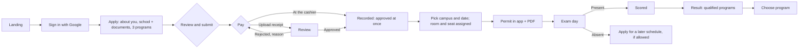
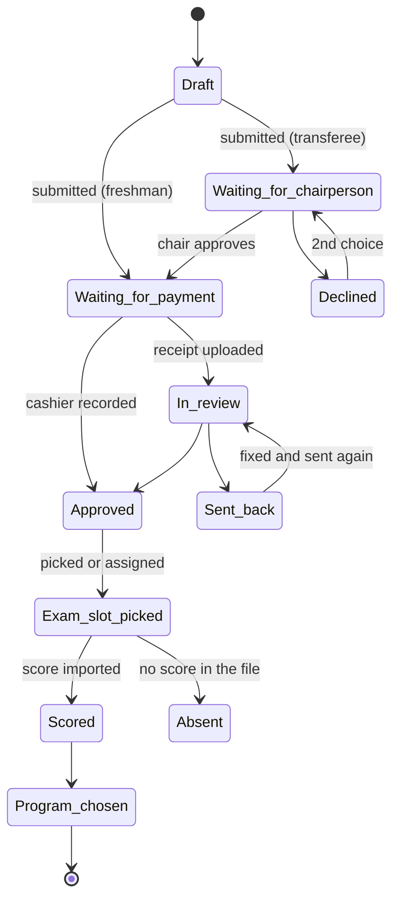
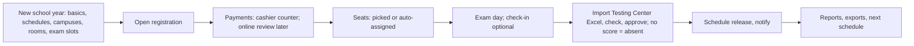
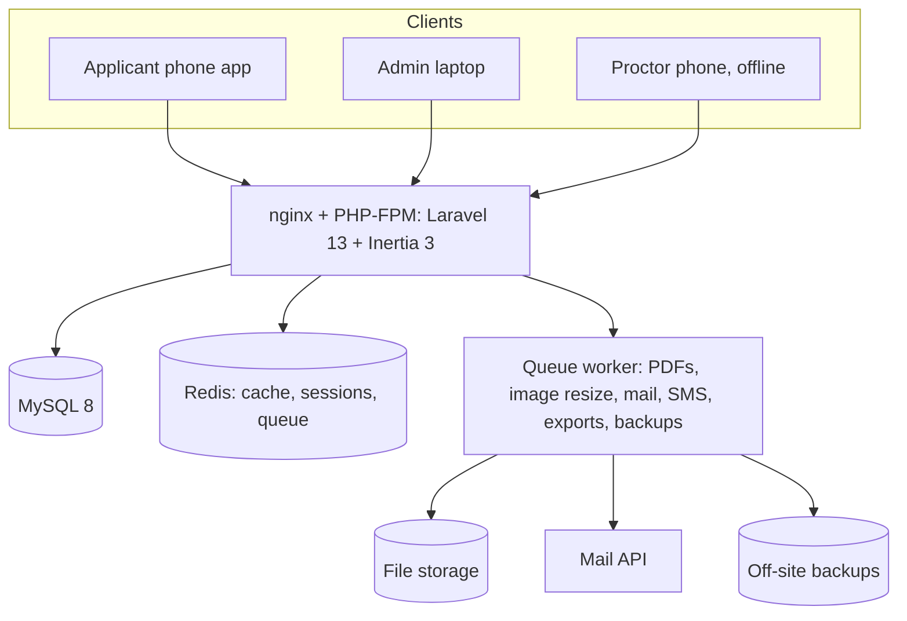

# SKSU TPT v4: PRD, flows and decisions

Written 28 Oct 2026 for the team discussion. Confidence tags: **[Certain]** = checked in code, data or the server; **[Likely]** = strong inference; **[Guessing]** = needs confirmation from the admission office.

The mockups that go with this document are in `mockups/`. Open `mockups/index.html`, then `ADMIN-JOURNEY-MOCKUP.html` and `APPLICANT-JOURNEY-MOCKUP.html`.

---

## 1. Decisions so far

| # | Decision | Why |
|---|---|---|
| 1 | Keep every function the old TPT performs; how each one works is ours to improve. | The user's mandate. |
| 2 | **A schedule is a day**: campus + date. The applicant picks campus and date, and the system assigns room and seat. Report and start times (for example 7:30 / 8:00 AM) are a guide printed on the permit, not a bookable slot. | It works like the Civil Service exam. It's simpler and matches how SKSU runs test days [Likely]. |
| 3 | **No morning/afternoon.** One exam session per exam day, with one guide report time and start time. There is **one exam slot per campus per day**; to fit more students, add rooms or another day (two slots on the same day would bring back morning/afternoon). | tptv3 hard-coded AM/PM, which split each day's seats in half (`slots / 2`); the office wants it removed. |
| 4 | **School years and schedules are data, never code.** A school year has one or more exam schedules, each marked Freshmen or Transferees, each with its own registration, exam day(s), seats, scores and release. | tptv3 has year-specific routes, templates and database names. |
| 5 | **For now, payment is at an SKSU cashier only**: the cashier records the OR no., the application is approved at once and the examinee number is issued. Online payment with a receipt upload and admin review is a **later switch per school year** ("Payment methods"), off by default. | The office has no online payment yet (user, 29 Oct). The online path stays designed so it can be turned on without new code. |
| 6 | Notifications are a core module: in-app and email per event in v1; SMS later (tptv3 has no SMS). | The user said notifying students is important. |
| 7 | Stack: Laravel 13, Inertia 3, Vue 3, TypeScript, shadcn-vue + Tailwind 4, Pest, MySQL 8, Redis, queue (Horizon). See TECH-PLAN.md. | Chosen for TPT's goals (clean, fast, optimized). |
| 8 | Look: SKSU deep green, mint and gold, the official seal, light mode. Applicant screens are a native-style mobile app; admin follows euphoria v2 admin patterns. | User feedback in this session. |

---

## 2. Core modules

| Module | What it covers | Mockups |
|---|---|---|
| School years and schedules | School year, one or more schedules (Freshmen or Transferees), registration windows, exam fee, copy from last school year (5-step form with a step rail) | `admin/schedules`, `admin/setup-1…5` |
| Campuses and programs | 7 campuses, programs per campus, offered per school year, board flag, **cut-off score** | `admin/campuses` |
| Rooms | Buildings and rooms per campus with exam seats; reused every school year; added one by one | `admin/rooms` |
| Schedule days | Campus + date + rooms → seats; guide times | `admin/exam-slots` |
| Applicants and applications | Google sign-in; profile, school, 3 program choices (2 for transferees); one status per application (see the status list in section 7) | `applicant/*`, `admin/applications`, `admin/applicant` |
| Uploads | Only what is used: 2×2 ID photo (for the permit), and the payment receipt only when online payment is turned on; transferees add their grades for the chairperson. Compressed on the phone; reviewer can ask for a new one | `applicant/apply-*`, `admin/applicant#photo` |
| Payments | Cashier records the OR number (instant) = approved. Online upload and review is a school-year switch, **later (off for now)**; duplicate-reference guard when on | `admin/cashier`, `admin/payments` |
| Permits | Examinee number from the school-year counter; wallet-style permit and PDF with QR; public verify page | `applicant/permit`, `docs/permit-pdf`, `public/verify` |
| Exam day | Optional, off by default: offline QR check-in on the proctor's phone, information only. Absent is decided by the score import | `proctor/*`, `admin/checkin` |
| Results import | Upload the Testing Center Excel as it is → match columns → checks → preview changes → approve → publish; every file kept unchanged | `admin/scores`, `admin/results` |
| Results and qualification | Standard score, stanine, qualified programs by cut-off; student chooses a program | `applicant/result`, `docs/result-pdf` |
| Notifications | Event → in-app and email (SMS later); templates, announcements, send log with resend | `applicant/notifications`, `admin/messages`, `docs/sms` |
| Reports and downloads | Funnel, demand, score histogram, every old report; background exports | `admin/reports`, `admin/exports` |
| Staff, roles, audit | Invite-only staff, four roles (Admin, Cashier, Proctor, Program chair), permission matrix; activity log (read-only) | `admin/staff`, `admin/audit` |

---

## 3. Old process → new process

| Old step (tptv3) | What it does | What's wrong | v4 |
|---|---|---|---|
| Google sign-in | Creates the user | Role overwritten on every login; `admin@gmail.com` becomes admin; 4,928 OAuth 400 errors [Certain] | Roles in the DB by invite; Google sign-in only; staff sign-in separate |
| Step middleware (`step_two` … `step_five`) | Gates pages | Progress stored three ways (`users.step`, `applications.status`, row existence) and drifts [Certain] | One status enum with allowed transitions and an event history |
| Personal / school / program forms | Collect data | Strings for dates and age; no autosave; 20 "Data too long" errors [Certain] | Typed fields, autosave, hints and limits shown before saving |
| Photo upload | 2×2 photo | Up to 100 MB, never resized; 26 GB on disk [Certain] | Shrunk on the phone to about 250 KB; face check; reviewer can ask for a new one |
| Payment proof upload | Reference + receipt | Every payment needs a manual review; `store() on null` errors [Certain] | Cashier records at the counter (instant); upload path kept as fallback with duplicate-reference guard |
| Approve payment | Issues examinee number | `max(examinee_number)+1` on a string; two admins collide [Certain] | Per-season counter, locked in the approval transaction |
| Select test center | Picks slot, computes room and seat | Count-then-insert with no lock; `slots / 2` hard-codes AM/PM; 357 "slots on null" errors [Certain] | Pick campus + date; seat assigned under a row lock with a unique key; auto-assign for stragglers |
| Permit PDF | Headless Chrome per request | 19,209 Browsershot errors [Certain] | Built once on the queue, cached; wallet-style permit works offline |
| Exam day | Paper lists | No attendance recorded; 635 registered with no result and no reason [Certain] | The score import marks anyone with a slot but no score as Absent; check-in is optional |
| Results upload (Excel) | Imports scores computed by the Testing Center | Columns read by position; header row saved as a result; no checks; re-upload duplicates; file not kept [Certain] | Same idea, import not compute: Excel as it is, column matching, checks, preview of changes, approval, original file kept |
| Survey + select courses before result | Gate to see the result | Forces a survey; second course pick duplicates choices [Certain] | Same 10 tptv3 statements (the office submits these results), required once after the result and before choosing a program; the admin can edit them per school year (new answers only); results report and Excel in the office format |
| Reports (6 Livewire pages) | Lists and exports | Slow full-table queries, missing indexes [Certain] | Same reports plus funnel, attendance and survey; exports queued |
| Emails | Approve/reject via Gmail SMTP | Gmail daily limit, no SMS, no log [Certain] | Mail service (no Gmail daily limit); templates; send log with resend; SMS later (no SMS in v1). |
| Test and debug routes | Left in production | Serious security risk (details kept offline) [Certain] | **Dropped.** Never ship test routes; route list checked in CI |
| One-off PHP scripts in `docs/` | Manual DB fixes | Each school year needs hand fixes [Certain] | **Dropped.** Admin screens cover every fix, with a reason and audit |

---

## 4. Known gaps in tptv3, per module

- **Applicants:** no duplicate detection; no email fallback for students without Google; nothing for students who signed up with the wrong account.
- **Applications:** no "returned for revision"; you can't edit after submitting without a DB edit.
- **Uploads:** no size limit worth the name, no compression, no review or replace flow, files kept forever.
- **Payments:** no cashier path, no duplicate-reference check, no record of who approved.
- **Schedules and rooms:** rooms are a count, not real rooms; no capacity per room; no way to move someone or close a day cleanly; the seat race.
- **Campuses and programs:** campus and program glued in one string in results; no cut-offs in the system.
- **Results import:** columns read by position, header row imported as data, no check against registrations or attendance, re-upload duplicates rows, no record of the file (see RESULTS-IMPORT.md).
- **Results:** labels and stanines stored, not computed; no qualification logic; release is a manual toggle.
- **Notifications:** two emails only; nothing for schedule change, reminders or results.
- **Admin:** admin by email list; no activity log; no roles beyond admin/applicant.
- **Operations:** no backups, 535 MB log, Ubuntu 20.04, root SSH with a password, test routes live.

---

## 5. Scenarios and how v4 handles them

| Scenario | v4 behaviour |
|---|---|
| Applicant wants another date | One self-service change until the schedule's change deadline; after that, staff move them with a reason. |
| No-show | The score import marks anyone with an exam slot but no score as Absent (check-in, if on, is only a note). A setting lets them move to a later schedule without paying again. |
| Room capacity changes | Edit the room's seats; if people already sit above the new capacity, the screen lists them and offers to move them before saving. |
| Exam date moved (typhoon, holiday) | Move the schedule day: everyone on it keeps their room and seat, gets a new permit, and is told in the app and by email at once. |
| Walk-in on exam day | Proctor can't add people. The campus admin can seat a walk-in only if they're approved and unscheduled, into an empty seat; it's logged. |
| Duplicate registration | Detector flags same name + birth date or same mobile. A flag only: staff cancel the newer application if it is the same person. No merge. |
| Late payment | Registration close blocks new payments; an admin can extend one applicant with a reason, or roll them to the next schedule. |
| A date overflows | Add rooms to that exam slot, or add another day. |
| Wrong room at the door | The scan says which room to send them to. |
| Lost permit | The permit lives in the app and works offline; the proctor can also search by name. |
| Score correction | Upload a fixed Excel file (the screen shows what changes), or correct one score with a reason; the old value is kept. |
| Two cashiers approve the same receipt | The second one is told and moved to the next item. |

**The Civil Service exam as the model** (from general knowledge, not fetched, so confirm the details): applicants file, choose a testing venue, and later get a notice with their school, room and seat. The exam is one fixed date with a reporting time printed on the admission slip. v4 does the same: you choose campus and date, room and seat are assigned, and times are a guide.

---

## 6. Notifications

v1 sends **in-app notices and email**. tptv3 has no SMS (email only, through Gmail). The SMS column shows what would be texted **later**, if SKSU picks a provider and budget; it is off in v1.

| Event | In app | Email | SMS (later) |
|---|---|---|---|
| Account created | ✓ | ✓ | |
| Application submitted | ✓ | ✓ | |
| Upload needs redoing (photo, ID, receipt) | ✓ | ✓ | ✓ |
| Receipt received | ✓ | ✓ | |
| Payment approved (examinee no.) | ✓ | ✓ | ✓ |
| Payment rejected (reason) | ✓ | ✓ | ✓ |
| Seat booked, permit ready | ✓ | ✓ | ✓ |
| Schedule changed | ✓ | ✓ | ✓ |
| Exam reminder (day before, 5 PM) | ✓ | ✓ | ✓ |
| Marked absent | ✓ | ✓ | |
| Results released | ✓ | ✓ | ✓ |

Every send is logged with delivery status and can be resent.

---

## 7. Data model

See **DATABASE.md** (tables, fields, indexes, transactions and real-world scenarios).

### Application statuses

One status per application. These exact names are used on every screen, in filters and in emails.

| Status | Means | Next |
|---|---|---|
| Draft | Started, not submitted | Submitted |
| Submitted | The moment of submitting (not a resting state) | Waiting for chairperson (transferees) or Waiting for payment (freshmen) |
| Waiting for chairperson | Transferee; the program chairperson checks grades and slots | Waiting for payment, or Declined |
| Declined | The chairperson said no, with a reason (the 2nd choice gets a turn) | Waiting for chairperson (2nd choice), or Cancelled |
| Waiting for payment | Pay at an SKSU cashier (online upload only if turned on) | Approved (cashier), or In review (online) |
| In review | Online payment only: the admin checks the receipt | Approved, or Sent back |
| Sent back | The admin sent back the photo or details (any time) or the receipt (online); the student fixes it and sends again | Back to the status it had |
| Approved | Paid at the cashier; examinee number issued. **Details are locked from here** | Exam slot picked |
| Exam slot picked | Has a campus and date, room and seat; permit ready | Scored, or Absent |
| Scored | Score imported from the Testing Center file | Program chosen |
| Absent | Had a slot but no score in the file | Draft in a later schedule (if allowed) |
| Program chosen | Picked one program they qualify for | — |
| Cancelled | Cancelled by the student or an admin, with a reason | — |

**Locked after approval.** Once an application is Approved (paid at the cashier, examinee number issued; for transferees also after the chairperson approves), the student can't change their details. The app shows them read-only with "Locked after approval. To change something, ask the admission office." and a **Request a change** support request. Only an admin can edit details after approval, with a reason; a change asked by the student shows its request number. Every change goes in the history and the activity log. Changing the exam slot after approval works only through a request, an admin's "Move exam slot", or the school year's "change once until a deadline" setting.

### Support requests

A small ticket system for questions and change requests (replaces "Ask the office").

| Rule | Value |
|---|---|
| Who | Signed-in applicants with an application |
| Topics | Payment, Application, Change my details, Exam slot, Result, Other |
| Statuses | Open → Answered → Closed. A student reply reopens it; it closes by itself after 7 days with no reply |
| Open at a time | 1. A new request only after the previous one is closed (by the office, or the student marks it solved) |
| Per school year | 5 per student. After that: "You've used your 5 requests for this school year. Visit or call the Guidance and Testing Center." |
| Replies | 1 a minute, 20 per request per day |
| Message | 10–1,000 characters; links shown as plain text |
| Photo | 1, optional, JPG or PNG, up to 2 MB, made smaller on the phone |
| Admin | Search, filters (status, topic, campus, assigned to me), oldest waiting first; reply, assign, close, close as duplicate, change details (with reason, linked to the request), pause a student's support for 7 days with a reason (logged) |

### Exam times

Times are a guide, not a booking rule, but students always see them: on the exam slot picker ("Sat, Apr 25 · report by 7:30 AM"), the confirm sheet, the permit ("Report by 7:30 AM · exam starts 8:00 AM"), Home, the "Exam slot booked" notification and the reminder SMS/email. Transferee schedules work the same: one exam day, one guide time.

## 8. Flows

### Applicant

### Application status

### Admin school year

### Architecture

---

## 9. Earlier attempts: what to reuse and why they stalled

| Folder | State | Reuse |
|---|---|---|
| `tpt-recreate` (Feb 2026, 6 commits) | Docs-first: stakeholders, modules, MVP lists, wireframes in Markdown; models and API started | Planning docs, enums, program qualification logic |
| `tpt-recreate-v2` (Feb–Mar 2026, 35 commits) | Laravel 12 + Inertia + Vue; models for Schedule, Room, CampusSlot, ExamSlotAssignment, Payment, Result, ResultScore, SmsLog, Ticket, Faq | Its PRD decisions: date-based schedule with auto room/seat, two payment paths, cut-offs (board 530, nursing/accountancy 600, med tech 650), documents (valid ID, Form 138), roles (super admin, campus admin, cashier) |

[Guessing] Why they stalled: scope grew before the core flow was finished (tickets, FAQs, real-time Reverb, a long SMS guide), there were no clickable mockups to agree on, and the admission school year arrived before a usable end-to-end path existed. To avoid that this time:

1. Agree on these mockups first.
2. Build one thin path end to end (apply → pay → seat → permit) before anything else.
3. Leave tickets, FAQs and real-time features for after the first school year.

---

## 10. Plan

| Phase | Weeks | Done when |
|---|---|---|
| 0 Lock down tptv3 | now | Test routes closed, repo private, backups running |
| 1 Foundation | 1–2 | Schema above, seed from `tpt_october_2025`, CI with Pest |
| 2 Apply and pay | 3–5 | Applicant can apply; the cashier counter records payments (online upload stays off) |
| 3 Schedule and permit | 6–7 | Days, rooms, locked seats, permit PDF and verify page |
| 4 Exam day and results | 8–9 | Score import (absent from import), release, qualification; optional check-in |
| 5 Notifications, reports, cut-over | 10 | Email templates, reports; load test; switch the address (SMS later) |

## 11. Open questions for the admission office

1. How many schedules a year, and which are for transferees? (The system allows any number.)
2. Confirm date-only scheduling with guide times. What are the real report and start times?
3. Exam fee, GCash and bank accounts, and whether cashiers will use the system.
4. Official stanine labels and the cut-off list per program for 2027.
5. SMS (later): which provider and budget, if SKSU wants texts? v1 works without it.
6. Can absent examinees move to the next schedule for free?
7. Confirm why the office wants morning/afternoon removed.

---

## 12. Admin UI rules

1. **One page template**: title (no description line) and the page's primary action top-right; then the filter bar; then the content. Nothing else above the fold.
2. **One focal point per page**: the main task is the biggest thing on the page (the dashboard's "Payments to review"). Everything else is smaller and greyer.
3. **One card**: 12 px radius, 1 px border, white, no shadow, 20 px padding. No mixed card shapes on a page.
4. **One table**: uppercase grey headers, 12 px vertical padding, row hover. Row actions are quiet until you hover (View in green text, ··· menu).
5. **Buttons**: sm 32 px (tables, toolbars), md 40 px (default), lg 48 px (main task); 52 px pills on mobile. One primary per view; secondary is white with a border, ghost is text only, and danger (red) is only for destructive actions. Disabled is 45% opacity. Loading shows a spinner in place of the label.
6. **Labels and positions**: labels sit above fields in plain words ("Official receipt no.", not `or_no`); optional fields say "(optional)". Buttons say what they do ("Record payment", "Approve and issue number"). In forms and dialogs, Cancel sits left of the primary action at the bottom-right; on mobile, actions are full width at the bottom.
7. **Spacing**: 8 px grid (8/16/24/32).
8. **Colour only where it means something**: green for the primary action and the selected item, status colours only on status badges, red only for errors and destructive actions. The sidebar and tables are neutral.
9. **Feedback**: skeletons shaped like the page while loading; an empty state has an icon, one line of reason and one action; toasts say what happened.

## 13. Usability walk-through (28 Oct)

| As… | Friction found | Fixed in the mockups |
|---|---|---|
| A first-time applicant on a phone | Long scrolling form; unclear how to pay; birth date format; mockups looked like a shrunk website | Native app layout (status bar, big titles, floating tab bar, bottom sheets, sticky main button); Pay-at-the-cashier screen with the code and pay-by date; date hint; autosave toast; wallet-style permit that works offline |
| A first-time applicant | Didn't know when to come or what to bring | Permit and seat screen show "Report by 7:30 AM · exam starts 8:00 AM" and what to bring; reminder (app + email) the day before |
| A registrar on a busy day | Too many equal boxes; no single thing to do first; dense rows with boxed buttons | Dashboard numbers that drive the work ("Paid today", "Needs attention"); light sidebar; quiet row actions; global search with `/`; saved views; bulk actions |
| A cashier | Every payment needed a photo and a second person | "Record a payment" at the counter: find the applicant, type the OR number, done |
| A proctor at the door | Paper lists; no signal in some rooms | Optional offline check-in with big Here and Not here buttons (a note only); wrong-room and duplicate warnings |

**Still weak**:

- Tables are wide on small laptops.
- Admin on a phone is usable but not designed screen by screen.
- The filter sheet on mobile is only a placeholder.
- Real content (program names, fees, the cut-off list) still needs the admission office.

## 14. Cashier role

- **Cashier** is its own role with a simple console (`cashier/console.html`). It can't open other admin pages; admins can open the console too.
- **What TPT records** is only that the applicant paid: OR number, amount, payment method, who recorded it, and when. Cash handling and remittance stay in the university's own accounting system, as today.
- **Counter flow:** search (name, application or examinee no.; no QR scanning at the counter) → the fee is fixed → type the OR number (must be unused) → Enter → paid, print an OR copy if needed → next person.
- **Guards:** already paid, OR already used, not found, schedule not open yet, fee waived.
- **Today:** the cashier's list for the day with reprint and an Excel export to match against the OR booklet. The cashier also sees a small info strip (today's count, applicants waiting, seats left per exam day) and an **Info** tab to answer questions at the counter: key dates, fee and requirements, exam days and seats left, rooms (seats, taken, left) and the programs open this school year. All of it is read-only.
- **Void (admin only):** a reason is required. The application goes back to "waiting for payment", and any seat is released if the exam hasn't happened. The applicant gets the reason in the app and by email, and can pay again as normal. The voided payment stays on the lists and in the activity log.
- **Data:** `payments.method = cashier`, `or_no` unique per school year, `recorded_by`, `counter`; voids recorded in the activity log.

## 15. Seats on the dashboard

The dashboard shows the schedule's seats (total, taken, left, open exam days) and each exam day and campus with a meter. "Nearly full" appears under 60 seats and "Full" at 0. Applicants see seats left per day on the schedule picker.

## Examinee numbers

- tptv3: 6 digits, the next number is the last one plus 1, starting from a number set in the code each year (500001 now; an older version used 411111). The office's start number changed by editing code.
- v4: the school year has an **examinee number pattern**: optional prefix, number of digits (default 6) and start number, with a live preview. It locks once the first number is given, and each new school year can use a new pattern, so the office can change the format later without code. The results import checks numbers against the school year's pattern.
- Numbers:  Numbers are issued in order when a payment is recorded (or the chairperson-approved transferee pays), from a counter locked in the same transaction, so two people never get the same number. The range can't overlap an earlier school year. An admin can correct a number with a reason (logged), like tptv3's "examinee_number_updated".
- To confirm with the office: the start number for the next school year, and whether transferee schedules share the same series.

## Permit format

- **Keep tptv3's permit format** (layout, wording and order of fields the office and proctors already know): see tptv3 `resources/views/applicant/permit.blade.php` and `resources/views/livewire/permit-layout.blade.php`. The v4 mockup permit is a placeholder for the data, not the final layout.
- What changes is speed and cleanliness: the permit is built once when the exam slot is booked (not on every view), saved as a small PDF, cached on the phone so it opens without signal, and the QR verifies on the public page.

- **Result paper:** keep tptv3's layout (result-pdf-2026.blade.php): letterhead, "Guidance and Testing Center", "SKSU TERTIARY PLACEMENT TEST RESULT", NAME OF EXAMINEE / EXAMINEE NUMBER / PREFERRED PROGRAM / DATE OF EXAMINATION, the SUBJECT · STANDARD SCORE · STANINE · QUALITATIVE INTERPRETATION table (English, Science, Mathematics, Filipino, Social Studies, ESM Competency Score, Overall Score), the Overall and ESM explanations, the cut-off scores per campus and program, and the three signatories (Prepared by, Interpreted by, Noted). v4 builds it on the server (dompdf) before release, so students download a ready file, and adds the photo and a verify QR. Stanine words as in tptv3: 9 Outstanding, 8–7 Above Average, 6 High Average, 5 Middle Average, 4 Low Average, 3–2 Below Average, 1 Low.
- **ESM rule (from tptv3's result):** the cut-off for Nursing, Midwifery, Medical Technology, Electronics/Civil/Computer Engineering, Computer Science, Fisheries, Biology, Accountancy, Management Accounting, Accounting Information Systems, Mathematics Education and Science Education is checked against the **ESM Competency Score**; every other program uses the **Overall Score**. Each program in Campuses and programs has "Cut-off based on: Overall score / ESM competency score" (pre-set to ESM for the programs above); the list shows it next to the cut-off ("530 · ESM"), and the student's result says which score each program used.
- **Privacy policy:** tptv3's privacy-policy.blade.php was reviewed and is likely outdated (it only covers Google sign-in data, not the application, photo, payment, scores or who sees them). v4 uses its own RA 10173 notice and terms, marked "Draft — for review by the SKSU Data Protection Officer"; only the office contact (sksutpt@gmail.com) is taken from tptv3. tptv3's terms text lives in its database (terms.blade.php only prints it).

## 16. Transferee test (2nd semester)

Today the Guidance and Testing Center runs a separate walk-in test for transferees (for example Dec 13, 2026, ₱275, Testing Room, SKSU ACCESS Campus; the post still lists a 1st and 2nd batch, which v4 drops). The paper form asks for personal details, current school, current course and two preferred programs, and the program chairperson or college dean signs it after checking grades and slots.

v4 handles it in the same system:

| Step | Freshmen schedule | Transferee schedule |
|---|---|---|
| Schedule type | Freshmen | Transferees (set when the schedule is created) |
| Apply | Online: 3 program choices | Online or encoded by staff: 2 choices, plus current school and current course, and the transcript or certificate of grades |
| Approval before paying | — | The program chairperson or the college dean of the 1st-choice program approves (slot available, grades OK) or declines with a reason, online or marked "evaluated in person" when the student brings documents; the approver's name and role are saved |
| Pay | Cashier (online later, if turned on) | Cashier only |
| Exam | Exam slots by campus and date | One exam day and venue, assigned automatically after payment |
| Examinee no., permit, results, choosing a program | Same | Same |

New role: **Program chair / Dean** (a chair covers one program, a dean every program in the college). Sees only the transferee applicants for their own program, with the uploaded grades, and approves or declines. Every decision goes in the activity log.

If the 1st-choice chairperson declines, the 2nd-choice chairperson gets a turn (the mockups show this). **Confirm with the office.**

## 17. Exam survey

The survey keeps tptv3's 10 statements word for word, because the office submits these results. Each new school year starts with them (copied from the last school year), and the admin can edit, add, reorder or switch off statements on the **Survey** page.

| Rule | v4 |
|---|---|
| Scale | Strongly Agree · Agree · Neither Disagree nor Agree · Disagree · Strongly Disagree (stored 1–5, 1 = Strongly Agree, as in tptv3) |
| When | After the result is released, before choosing a program (setting "Required before choosing a program", on by default) |
| Answers | All statements required, comments and suggestions optional; once per student per school year |
| Changing questions | Applies to new answers only. If anyone has answered this school year, saving starts a new version; answers keep the version they answered, and results show each version separately |
| Results | Survey results report: count per answer, average, agree-to-disagree bar, comments with search; Excel with one row per statement and the count per answer (the office's format) |

Default statements (tptv3):

1. The pre-registration process is easy and convenient.
2. The testing personnel (ex. examiners, proctors, peer helpers, security guards and staff) responds efficiently to the needs and concerns of the examinees.
3. The signages in the testing site are visible and easy to follow.
4. There are enough rooms and facilities to cater the examinees.
5. The testing room is conducive and well-ventilated.
6. The examinees are well-guided of the instructions and procedures before, during and after the examination.
7. The test materials are readable, sufficient and in good condition.
8. The duration of the test is adequate.
9. The test items per subject are adequate and appropriate.
10. The test questions are comprehensible.

Plus "Comments and suggestions (optional)".

## Privacy and consent

- Public page `privacy.html` has two parts: **Privacy notice** (who we are, what we collect, why, who can see it, service providers, how long, security, rights, cookies, minors, changes) and **Terms of use** (one account per person, true information with the paper form's certification wording, keep the permit to yourself, no abuse of Support, the office may cancel false applications). It follows the Data Privacy Act of 2012 (RA 10173).
- Consent: an unticked, required checkbox at sign-up and on the Review step ("I have read the Privacy notice and the Terms of use"). Store the notice **version and the time** of consent with the account; a new version asks again.
- Privacy requests come through Support (topic "Privacy request") or the DPO's email. System status shows the data-retention rule and the next clean-up date.
- Questions for the Data Protection Officer: retention period for applications, results and photos; whether applicants under 18 need a parent or guardian's consent; the DPO's name and contact.

## Lists, filters and guidance

- Every admin and cashier list uses one pattern (`list_page`): muted count and page actions on the title line, status tabs with counts when the list has statuses, one filter line (a search box that says exactly what it searches plus at most two selects), the table in one white panel, and a "1–25 of N" footer. Rows show the one action that fits the row plus View; rare or risky actions sit under "···".
- Home location filter (Province → Municipality or city) sits behind "More filters" on Applications, Results and Survey results. The student form records the address as Province → Municipality or city → Barangay (lists, not free text) plus an optional street, so the filter and the "Applicants by home town" report are accurate.
- Guidance like euphoria: a setup line under page titles while a new school year is unfinished (with a Setup checklist page), a Guide button on complex pages (what it's for, how it works, examples), and the step rail on long forms. Staff can hide any of it; My account → Guides turns it back on.

## Maintenance and pauses

System status → Maintenance (super admin only). Each switch asks for a reason and says plainly what stops and what still works; every pause and resume goes in the activity log with who and when.

| Pause | Stops | Still works |
|---|---|---|
| Student app | Students and the landing page see a maintenance screen with a "back by" time | Staff sign in and work; permits saved on phones open offline; nothing is lost |
| New applications | Nobody can start or submit an application | Status, permit and results; cashier payments |
| Cashier payments | The counter can't record; cashiers see "Payments paused by … at …" | Applying and waiting; recorded payments stay |
| Hide results | Students stop seeing results (Results page control) | Everything else |

Scheduled maintenance: a date and time window plus a message; students see a notice on Home before it starts. While the student app is paused, the admin header shows a thin line "Student app paused · Resume".

## Where, when creating

- The schedule form has a **Where** section: one checkbox per campus that holds the exam (all ticked by default), each showing its exam rooms and seats from Rooms. Saving creates one exam slot per campus and exam day with that campus's rooms; staff adjust them on Exam slots.
- A transferee schedule picks one campus and one room (venue).
- **Check-in** is a per-schedule switch (off by default). When on, the live monitor opens from that schedule's row and from Exam slots, and the Dashboard shows the count on exam day.

## Decisions from the final gap check (29 Oct)

- **One exam slot per campus per day** (a second one the same day would bring back morning/afternoon). The Add exam slot form blocks it with a plain message pointing to Add rooms.
- **Super admin**: an Admin with the Super admin switch manages System, maintenance and staff roles. At least one super admin always exists.
- **Voids**: a voided OR stays on the list as voided; the examinee number it issued is retired, never reused.
- **Score corrections** are stored exactly as the Testing Center gives them (never recomputed); the student is notified and the result PDF is rebuilt; old and new values stay in the history.
- **Duplicates**: until the office decides the once-per-school-year rule, the cashier and the import show "possible duplicate" warnings (same name + birth date, or same mobile).
- **Separation of duties**: cashiers take payments; the office creates applications. An admin can switch on "Can also create walk-in applications" for a cashier (logged).
- **Dates** close at 11:59 PM, Philippine time. "Pay at the cashier by" comes after registration closes. "Change exam slot until" is set per schedule.
- **Unpublishing** a schedule keeps drafts; publishing a schedule with no exam slots shows a warning.
- **Closing a school year** runs a checklist (open support requests, programs not chosen, shifts closed, office summary exported), then the year is read-only.

## Cashier: real-world scenarios

| Situation | What happens |
|---|---|
| Brownout or no internet | The counter can't record (no offline recording). The cashier issues the paper OR as usual and later uses **Record a paper payment** (OR no., when it was paid, reason). It is flagged **Recorded late** for admin review; the examinee no. is issued when recorded. |
| Same OR no. already used (any counter) | Blocked: "OR 0048213 was already used at 9:41 for Ricky P. Ulangkaya (Isulan counter 1)." |
| OR no. outside the counter's booklet | Blocked: "0051002 is not in your booklet (0048001–0048500)." |
| Skipped OR numbers | Warning, not a block: "You skipped 0048215–0048216. Were they spoiled?" Mark as spoiled (reason) or fix the number. Spoiled ORs appear on the end-of-shift list. |
| Wrong OR format | Field error: "OR no. is 7 digits." |
| Booklet runs out mid-shift | "Last OR in this booklet." The cashier adds the next booklet if the admin allows it, else asks the admin. |
| Record pressed twice | "Already recorded by you at 10:02." Nothing is recorded twice. |
| Lost code or forgotten email | Search by name, then check birth date or mobile and the photo. |
| Someone pays for a friend | Allowed. The photo and name check is about the applicant; the slip shows the applicant's name. |
| Wrong amount offered | The fee is fixed; no partial payments. Change is computed. |
| Paid but the app still says waiting | Paid list → **Resend confirmation** (app and email). |
| After registration closed | Blocked, unless the admin extended this applicant ("Extended until Apr 12 by Ana R."). |
| Fee waived | "Fee waived · nothing to collect"; recorded without an OR. |
| Possible duplicate | "Jomar Abdullah (same mobile) already paid today, 509783." Ask before taking money. |
| Not in the list | "They need to apply first (Admission office)", unless this cashier may create walk-in applications. |
| Signs out or switches counter mid-shift | The shift stays open; sign-out warns "Your shift is still open". |
| Two cashiers at one campus | Each has their own counter and booklet; totals per counter and per campus. |
| Start of the day | **Start of shift**: confirm the first OR no. and the starting cash. |
| End of the day | **End of shift**: expected vs counted cash; a note is required if they differ; list of payments, spoiled and voided ORs; print, close shift. The admin sees every shift. |
| After recording | **Print slip**: name, examinee no., OR no., amount, counter, and "Next: pick your exam slot" with a QR to the app. |

## Open questions added (29 Oct)

- Once per school year: may someone who already got a result take the test again in the same school year?
- Does the office want a printed slip for every payment, or only on request?

## Student result: on screen, then a ready PDF

- **On screen first:** the result screen shows the summary only: Qualified / Not qualified for your choices / Absent, overall standard score and stanine, the programs they qualify for, and the next step (survey, then choose a program; or apply in a later schedule / open a support request). It is light, so results day stays fast.
- **Full result PDF, pre-built:** so the official tptv3 layout looks identical on every phone, the server builds each student's result PDF **in the background between Approve and Publish** (for example overnight). At release the student taps "Download full result (PDF)" and gets a ready file: nothing is built at peak time. A corrected score rebuilds only that student's PDF.
- **How the PDFs are built:** a background queue with **1 worker**, one PDF at a time, low priority; it pauses by itself when the site is busy. A lightweight PDF engine (dompdf-style, not a headless browser) from the tptv3 layout: about **0.3–0.5 s and ~100 KB per PDF**, so **10,000 take about 1–1.5 hours and ~1 GB** on the 2-core server. The queue starts with one click on **Prepare result PDFs** (one student can be prepared early with **Prepare now**). Only a corrected score rebuilds a PDF (that student's). Publishing before all PDFs are ready turns into "prepare, then publish by itself when ready" (the default). Only a super admin can publish without PDFs, as an emergency, with a reason and typing PUBLISH (logged); students then see the result on screen and each PDF says "available soon".
- **Admin Results page:** shows "Result PDFs: 9,088 of 9,088 ready" (while building: "6,210 of 9,088"). If PDFs aren't ready, the main button reads **Prepare, then publish**; if some fail it shows "Build failed for 2 · Retry"; "Publish when the PDFs are ready" releases automatically once the release date has passed.
- **Release plan (admin, at Publish):** a calm dialog with defaults pre-chosen:
  - When: now, or at a set time.
  - Notify students: in waves (recommended; e.g. 9,088 students in 6 waves of ~1,500 every 5 minutes over 30 minutes, optionally campus by campus) or all at once.
  - Full result PDF: ready at release (recommended), allow downloads 1 hour after release, or off for now (screen only). This stays a switch the admin can change later; students then see "Your full result PDF will be available soon; your result is shown here".
  - A checklist (not blocking): scores approved, PDFs ready, release time set, server boost for results day (ask IT).
  - After release, a live "Release in progress" panel: waves sent, students who opened their result, PDF downloads, server busy level (from System status), with Pause notifications and Pause PDF downloads.
- **On-screen result from cache:** the result screen is served from a ready copy built at approve time, so thousands can open it at once without hitting the database.
- **Student flow board:** mockups/APPLICANT-JOURNEY-MOCKUP.html shows the whole path in order, numbered 1–13, with online payment (6b–6d) drawn dashed as "off for now".
