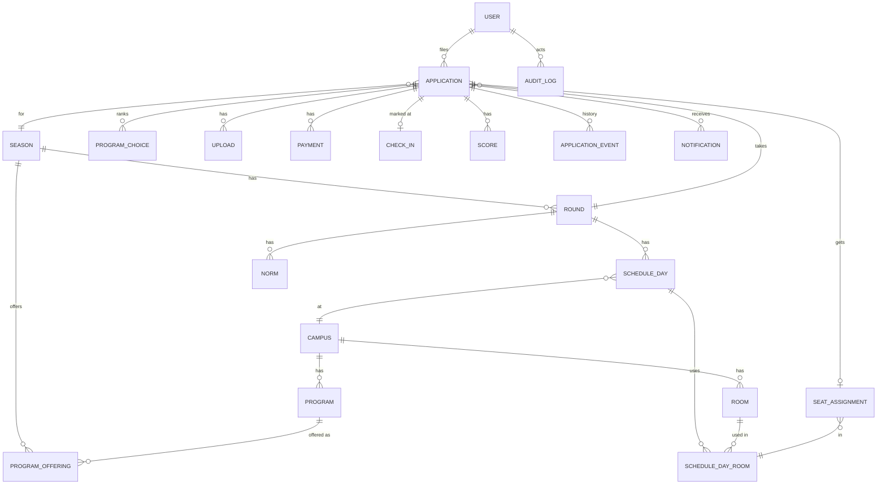
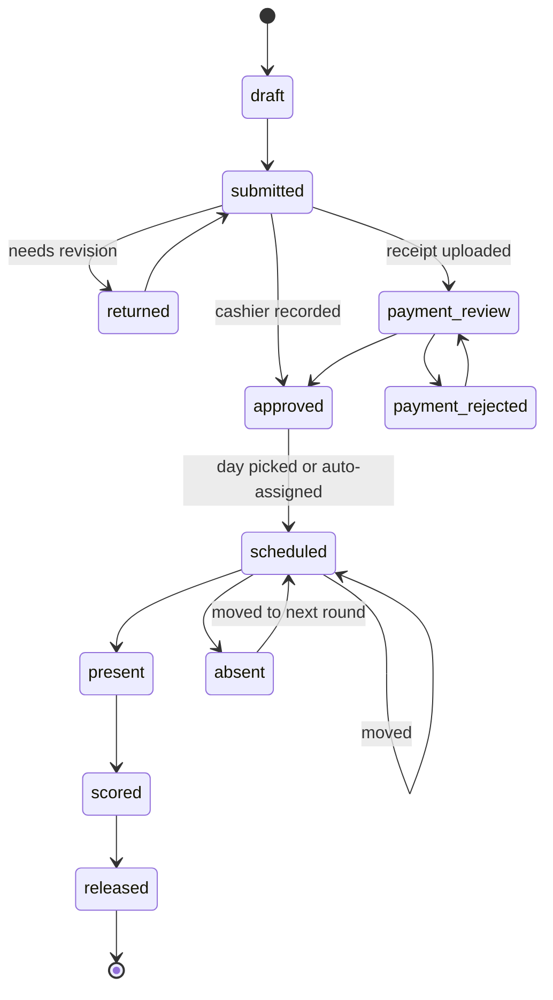
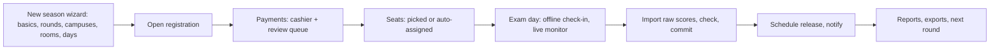
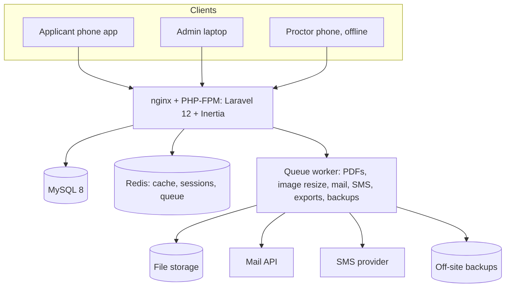

# SKSU TPT v4: PRD, flows and decisions

Written 28 Oct 2026 for the team discussion. Confidence tags: **[Certain]** = checked in code, data or the server; **[Likely]** = strong inference; **[Guessing]** = needs confirmation from the admission office.

The mockups that go with this document are in `mockups/`. Open `mockups/index.html`, then `ADMIN-JOURNEY-MOCKUP.html` and `APPLICANT-JOURNEY-MOCKUP.html`.

---

## 1. Decisions so far

| # | Decision | Why |
|---|---|---|
| 1 | Keep every function the old TPT performs; how each one works is ours to improve. | The user's mandate. |
| 2 | **A schedule is a day**: campus + date. The applicant picks campus and date, and the system assigns room and seat. Report and start times (for example 7:30 / 8:00 AM) are a guide printed on the permit, not a bookable slot. | It works like the Civil Service exam. It's simpler and matches how SKSU runs test days [Likely]. |
| 3 | AM/PM "sittings" stay as a switch, **off by default**, for a day that overflows. | tptv3 hard-coded times, which split seats in half (`slots / 2`). |
| 4 | **Seasons and rounds are data, never code.** A season is one school year with 1 to 3 exam rounds ("three schedules"), each with its own registration, exam day(s), seats, scores and release. | tptv3 has year-specific routes, templates and database names. |
| 5 | Two payment paths: the **cashier records** the payment at the counter (approved at once), or the applicant **uploads a receipt** and a reviewer checks it. | From the earlier tpt-recreate-v2 PRD; it removes most of the review queue. |
| 6 | Notifications are a core module: in-app, email and SMS per event. | The user said notifying students is important. |
| 7 | Stack: Laravel 12, Inertia, Vue 3, Tailwind 4, Nuxt UI or shadcn-vue, Pest, MySQL 8, Redis, queue worker. | The same stack as the team's euphoria v2 and the earlier tpt-recreate-v2 attempt. |
| 8 | Look: SKSU deep green, mint and gold, the official seal, light mode. Applicant screens are a native-style mobile app; admin follows euphoria v2 admin patterns. | User feedback in this session. |

---

## 2. Core modules

| Module | What it covers | Mockups |
|---|---|---|
| Seasons and rounds | School year, 1–3 rounds, registration windows, exam fee, copy from last season (5-step wizard) | `admin/seasons`, `admin/setup-1…5` |
| Campuses and programs | 7 campuses, programs per campus, offered per season, board flag, **cut-off score** | `admin/campuses` |
| Rooms | Buildings and rooms per campus with exam seats; reused every season; CSV import | `admin/rooms` |
| Schedule days | Campus + date + rooms → seats; guide times; optional sittings | `admin/sessions` |
| Applicants and applications | Google or email-link sign-in; profile, school, 3 program choices; one status per application | `applicant/*`, `admin/applications`, `admin/applicant` |
| Uploads | 2×2 photo, Form 138, valid ID, payment receipt; compressed on the phone; reviewer can ask for a new one | `applicant/apply-*`, `admin/applicant#photo` |
| Payments | Cashier records the OR number (instant), or upload and review; duplicate-reference guard | `admin/cashier`, `admin/payments` |
| Permits | Examinee number from a per-season counter; wallet-style permit and PDF with QR; public verify page | `applicant/permit`, `docs/permit-pdf`, `public/verify` |
| Exam day | Offline QR check-in on the proctor's phone; live monitor | `proctor/*`, `admin/checkin` |
| Results import | Raw scores → checks → norms → commit → scheduled release | `admin/scores`, `admin/results` |
| Results and qualification | Standard score, stanine, qualified programs by cut-off; student chooses a program | `applicant/result`, `docs/result-pdf` |
| Notifications | Event → in-app, email, SMS; templates, blasts, send log with resend; student preferences | `applicant/notifications`, `admin/messages`, `docs/sms` |
| Reports and downloads | Funnel, demand, score histogram, every old report; background exports | `admin/reports`, `admin/exports` |
| Staff, roles, audit | Invite-only staff, fixed roles, permission matrix; audit log with undo | `admin/staff`, `admin/audit` |

---

## 3. Old process → new process

| Old step (tptv3) | What it does | What's wrong | v4 |
|---|---|---|---|
| Google sign-in | Creates the user | Role overwritten on every login; `admin@gmail.com` becomes admin; 4,928 OAuth 400 errors [Certain] | Roles in the DB by invite; email-link fallback; staff sign-in separate |
| Step middleware (`step_two` … `step_five`) | Gates pages | Progress stored three ways (`users.step`, `applications.status`, row existence) and drifts [Certain] | One status enum with allowed transitions and an event history |
| Personal / school / program forms | Collect data | Strings for dates and age; no autosave; 20 "Data too long" errors [Certain] | Typed fields, autosave, hints and limits shown before saving |
| Photo upload | 2×2 photo | Up to 100 MB, never resized; 26 GB on disk [Certain] | Shrunk on the phone to about 250 KB; face check; reviewer can ask for a new one |
| Payment proof upload | Reference + receipt | Every payment needs a manual review; `store() on null` errors [Certain] | Cashier records at the counter (instant); upload path kept as fallback with duplicate-reference guard |
| Approve payment | Issues examinee number | `max(examinee_number)+1` on a string; two admins collide [Certain] | Per-season counter, locked in the approval transaction |
| Select test center | Picks slot, computes room and seat | Count-then-insert with no lock; `slots / 2` hard-codes AM/PM; 357 "slots on null" errors [Certain] | Pick campus + date; seat assigned under a row lock with a unique key; auto-assign for stragglers |
| Permit PDF | Headless Chrome per request | 19,209 Browsershot errors [Certain] | Built once on the queue, cached; wallet-style permit works offline |
| Exam day | Paper lists | No attendance recorded; 635 registered with no result and no reason [Certain] | Offline QR check-in; absent is a status |
| Results upload (Excel) | Imports standard scores | No raw scores; derived values stored as text; two tables glued in one CSV [Certain] | Raw scores in, norms computed, problem rows listed, commit, scheduled release |
| Survey + select courses before result | Gate to see the result | Forces a survey; second course pick duplicates choices [Certain] | Survey optional; choice of program happens after results, limited to programs they qualify for |
| Reports (6 Livewire pages) | Lists and exports | Slow full-table queries, missing indexes [Certain] | Same reports plus funnel, attendance and survey; exports queued |
| Emails | Approve/reject via Gmail SMTP | Gmail daily limit, no SMS, no log [Certain] | Mail API + SMS provider; templates; send log with resend |
| Test and debug routes | Left in production | Serious security risk (details kept offline) [Certain] | **Dropped.** Never ship test routes; route list checked in CI |
| One-off PHP scripts in `docs/` | Manual DB fixes | Each season needs hand fixes [Certain] | **Dropped.** Admin screens cover every fix, with a reason and audit |

---

## 4. Known gaps in tptv3, per module

- **Applicants:** no duplicate detection; no email fallback for students without Google; nothing for students who signed up with the wrong account.
- **Applications:** no "returned for revision"; you can't edit after submitting without a DB edit.
- **Uploads:** no size limit worth the name, no compression, no review or replace flow, files kept forever.
- **Payments:** no cashier path, no duplicate-reference check, no record of who approved.
- **Schedules and rooms:** rooms are a count, not real rooms; no capacity per room; no way to move someone or close a day cleanly; the seat race.
- **Campuses and programs:** campus and program glued in one string in results; no cut-offs in the system.
- **Results import:** no raw scores, no validation preview, no norms, no attendance link, can't correct one score.
- **Results:** labels and stanines stored, not computed; no qualification logic; release is a manual toggle.
- **Notifications:** two emails only; nothing for schedule change, reminders or results.
- **Admin:** admin by email list; no audit log; no roles beyond admin/applicant.
- **Operations:** no backups, 535 MB log, Ubuntu 20.04, root SSH with a password, test routes live.

---

## 5. Scenarios and how v4 handles them

| Scenario | v4 behaviour |
|---|---|
| Applicant wants another date | One self-service change until the round's cut-off date; after that, staff move them with a reason. |
| No-show | Proctor marks absent, or unscanned at room close → absent. A setting lets them move to the next round for free. |
| Room capacity changes | Edit the room's seats; if people already sit above the new capacity, the screen lists them and offers to move them before saving. |
| Exam date moved (typhoon, holiday) | Move the schedule day: everyone on it keeps their room and seat, gets a new permit, and receives SMS + email at once. |
| Walk-in on exam day | Proctor can't add people. The campus admin can seat a walk-in only if they're approved and unscheduled, into an empty seat; it's logged. |
| Duplicate registration | Detector flags same name + birth date or same mobile; merge keeps the older account and its payment and seat; undo for 7 days. |
| Late payment | Registration close blocks new payments; an admin can extend one applicant with a reason, or roll them to the next round. |
| A date overflows | Add rooms or another day; as a last resort, switch on AM/PM sittings for that day. |
| Wrong room at the door | The scan says which room to send them to. |
| Lost permit | The permit lives in the app and works offline; the proctor can also search by name. |
| Score correction | Admin corrects a raw score with a reason; the standard score recomputes; old value kept. |
| Two cashiers approve the same receipt | The second one is told and moved to the next item. |

**The Civil Service exam as the model** (from general knowledge, not fetched, so confirm the details): applicants file, choose a testing venue, and later get a notice with their school, room and seat. The exam is one fixed date with a reporting time printed on the admission slip. v4 does the same: you choose campus and date, room and seat are assigned, and times are a guide.

---

## 6. Notifications

| Event | In app | Email | SMS |
|---|---|---|---|
| Account created | ✓ | ✓ | |
| Application submitted | ✓ | ✓ | |
| Upload needs redoing (photo, ID, receipt) | ✓ | ✓ | ✓ |
| Receipt received | ✓ | ✓ | |
| Payment approved (examinee no.) | ✓ | ✓ | ✓ |
| Payment rejected (reason) | ✓ | ✓ | ✓ |
| Seat booked, permit ready | ✓ | ✓ | ✓ |
| Schedule changed | ✓ | ✓ | ✓ |
| Exam reminder (day before, 5 PM) | ✓ | ✓ | ✓ |
| Marked absent | ✓ | ✓ | |
| Results released | ✓ | ✓ | ✓ |

Students can turn texts off except for approvals, schedule changes, reminders and results. Every send is logged with delivery status and can be resent.

---

## 7. Data model

Key rules:

- `applications`: unique (user, season); `status` enum; `examinee_no` INT, unique per season, from `seasons.next_examinee_no` locked in the approval transaction.
- `seat_assignments`: unique (schedule_day_room, seat) and unique (application). Assigned under `SELECT … FOR UPDATE`.
- `schedule_days`: campus, date, `report_at` and `starts_at` (guide), `sitting` nullable (only when the sittings switch is on).
- `scores`: raw INT per subject; standard score, stanine and label are computed from `norms` and frozen in a release snapshot.
- `program_offerings`: season, program, `cutoff` INT, `is_board` bool.
- `payments`: `method` (cashier | upload), `or_no` or `reference_no` unique per season, `recorded_by`.
- Every FK is indexed; dates are DATE or DATETIME; no year in any table name, route or file name.

---

## 8. Flows

### Applicant

```mermaid
flowchart LR
    A[Landing] --> B[Sign in: Google or email link]
    B --> C[Apply: about you, school + documents, 3 programs]
    C --> D{Review and submit}
    D --> E{Pay}
    E -->|At the cashier| F[Recorded: approved at once]
    E -->|Upload receipt| G[Review] -->|Approved| F
    G -->|Rejected, reason| E
    F --> H[Pick campus and date; room and seat assigned]
    H --> I[Permit in app + PDF]
    I --> J[Exam day: QR check-in]
    J -->|Present| K[Scored] --> L[Result: qualified programs] --> M[Choose program]
    J -->|Absent| N[Move to next round, if allowed]
```

### Application status

### Admin season

### Architecture

---

## 9. Earlier attempts: what to reuse and why they stalled

| Folder | State | Reuse |
|---|---|---|
| `tpt-recreate` (Feb 2026, 6 commits) | Docs-first: stakeholders, modules, MVP lists, wireframes in Markdown; models and API started | Planning docs, enums, program qualification logic |
| `tpt-recreate-v2` (Feb–Mar 2026, 35 commits) | Laravel 12 + Inertia + Vue; models for Schedule, Room, CampusSlot, ExamSlotAssignment, Payment, Result, ResultScore, SmsLog, Ticket, Faq | Its PRD decisions: date-based schedule with auto room/seat, two payment paths, cut-offs (board 530, nursing/accountancy 600, med tech 650), documents (valid ID, Form 138), roles (super admin, campus admin, cashier) |

[Guessing] Why they stalled: scope grew before the core flow was finished (tickets, FAQs, real-time Reverb, a long SMS guide), there were no clickable mockups to agree on, and the admission season arrived before a usable end-to-end path existed. To avoid that this time:

1. Agree on these mockups first.
2. Build one thin path end to end (apply → pay → seat → permit) before anything else.
3. Leave tickets, FAQs and real-time features for after the first season.

---

## 10. Plan

| Phase | Weeks | Done when |
|---|---|---|
| 0 Lock down tptv3 | now | Test routes closed, repo private, backups running |
| 1 Foundation | 1–2 | Schema above, seed from `tpt_october_2025`, CI with Pest |
| 2 Apply and pay | 3–5 | Applicant can apply; cashier and upload paths work |
| 3 Schedule and permit | 6–7 | Days, rooms, locked seats, permit PDF and verify page |
| 4 Exam day and results | 8–9 | Offline check-in, score import, release, qualification |
| 5 Notifications, reports, cut-over | 10 | Templates, SMS, reports; load test; switch DNS |

## 11. Open questions for the admission office

1. Is "three schedules" three rounds a year? Or something else?
2. Confirm date-only scheduling with guide times. What are the real report and start times?
3. Exam fee, GCash and bank accounts, and whether cashiers will use the system.
4. Official stanine labels and the cut-off list per program for 2027.
5. Which SMS provider and budget?
6. Can absent examinees move to the next round for free?

---

## 12. Admin UI rules

1. **One page template**: title, one-line description and the page's primary action top-right; then the filter bar; then the content. Nothing else above the fold.
2. **One focal point per page**: the main task is the biggest thing on the page (the dashboard's "Payments to review"). Everything else is smaller and greyer.
3. **One card**: 12 px radius, 1 px border, white, no shadow, 20 px padding. No mixed card shapes on a page.
4. **One table**: uppercase grey headers, 12 px vertical padding, row hover. Row actions are quiet until you hover (View in green text, ··· menu).
5. **Buttons**: sm 32 px (tables, toolbars), md 40 px (default), lg 48 px (main task); 52 px pills on mobile. One primary per view; secondary is white with a border, ghost is text only, and danger (red) is only for destructive actions. Disabled is 45% opacity. Loading shows a spinner in place of the label.
6. **Labels and positions**: labels sit above fields in plain words ("Official receipt no.", not `or_no`); optional fields say "(optional)". Buttons say what they do ("Record payment", "Approve and issue number"). In forms and dialogs, Cancel sits left of the primary action at the bottom-right; on mobile, actions are full width at the bottom.
7. **Spacing**: 8 px grid (8/16/24/32).
8. **Colour only where it means something**: green for the primary action and the selected item, status colours only on status badges, red only for errors and destructive actions. The sidebar and tables are neutral.
9. **Feedback**: skeletons shaped like the page while loading; an empty state has an icon, one line of reason and one action; toasts say what happened and offer Undo when possible.

## 13. Usability walk-through (28 Oct)

| As… | Friction found | Fixed in the mockups |
|---|---|---|
| A first-time applicant on a phone | Long scrolling form; unclear how to pay; birth date format; mockups looked like a shrunk website | Native app layout (status bar, big titles, floating tab bar, bottom sheets, sticky main button); GCash steps on the payment screen; date hint; autosave toast; wallet-style permit that works offline |
| A first-time applicant | Didn't know when to come or what to bring | Permit and seat screen show "Report by 7:30 AM · exam starts 8:00 AM" and what to bring; reminder text the day before |
| A registrar on a busy day | Too many equal boxes; no single thing to do first; dense rows with boxed buttons | One focal KPI with "Review now"; light sidebar; quiet row actions; global search with `/`; saved views; bulk actions |
| A cashier | Every payment needed a photo and a second person | "Record a payment" at the counter: find the applicant, type the OR number, done |
| A proctor at the door | Paper lists; no signal in some rooms | Offline check-in with big Present and Absent buttons; wrong-room and duplicate warnings |

**Still weak**:

- Tables are wide on small laptops.
- Admin on a phone is usable but not designed screen by screen.
- The filter sheet on mobile is only a placeholder.
- Real content (program names, fees, the cut-off list) still needs the admission office.
