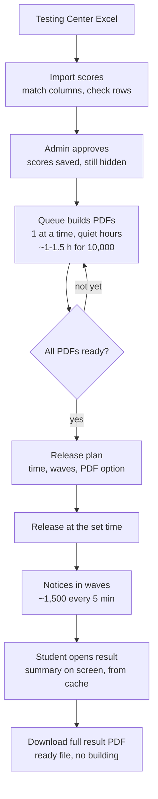
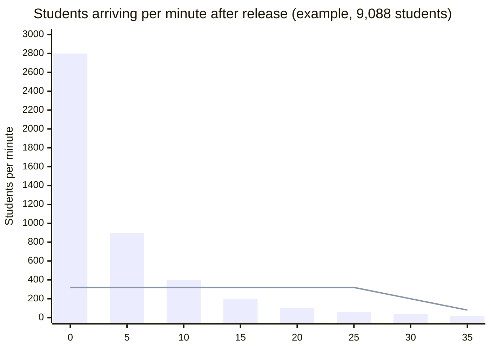

# Results release plan

How results go out without overloading the 2-core server. Students see their result on screen; the full result is the official tptv3-layout PDF, built before release.

## 1. The whole path

## 2. Why waves matter

The bars are everyone told at once: a spike in the first minute. The line is the same students told in 6 waves: a steady, low stream the server handles easily.

## 3. What the server does at each moment

| Moment | Server work | Load |
|---|---|---|
| Import and check | Read one Excel file | Short |
| Build PDFs (night before) | 1 PDF at a time, pauses if the site is busy | Low, nobody online |
| Release | Send notices in waves (background) | Low |
| Student opens result | Send a small cached summary | Very low |
| Download PDF | Send a ready file | Very low |
| Score corrected later | Rebuild that one PDF | Tiny |

## 4. Admin controls

- **Publish → Release plan:** now or at a time; notify all at once or in waves (recommended); PDF ready before release (recommended), open after 1 hour, or off for now.
- **Checklist:** PDFs ready, scores approved, time set, server boost for results day (ask IT).
- **While it runs:** waves sent, students who opened their result, PDF downloads, server busy level; **Pause notifications** and **Pause PDF downloads**.
- **Hide results** any time.
