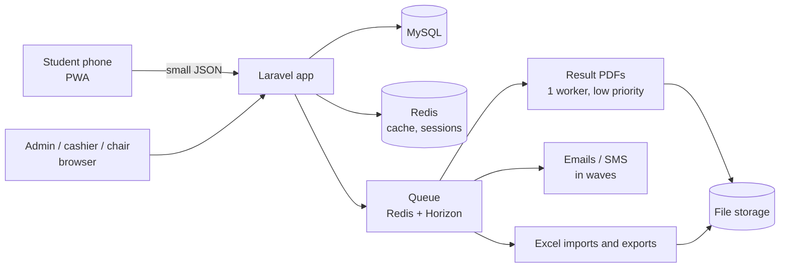

# Tech plan

What SKSU TPT v4 is built with, and why. Every choice is made for TPT's own goals: **clean, fast, optimized**. Euphoria is only a reference; where its choice is also the best fit for TPT, we use it. Items marked **Decide** need your answer.

## 1. The stack

| Part | Choice | Why |
|---|---|---|
| Backend | **Laravel 12**, PHP 8.4 | Mature, secure, fast to build with; the TPT server already runs PHP 8.4 |
| Database | **MySQL 8** | Already on the server; tptv3 data can be read for reference |
| Screens | **Inertia 2 + Vue 3 + TypeScript** | Pages load once, then only small JSON moves (fast on phones). Not Livewire: every click going back to the server is part of why tptv3 is slow |
| Components | **shadcn-vue** (on Reka UI) **+ Tailwind 4** | **Decided.** We own every component, so the app ships only what it uses (small downloads on low-end phones and mobile data) and matches the calm SKSU design exactly. Accessible by default (Reka UI). Data tables with TanStack Table; date pickers, dialogs, drawers and sheets from the same set |
| Student app | **PWA** (installable web app) | Install from the website on Android and iPhone; no APK, no store; offline permit |
| Sign-in | **Google** (Laravel Socialite) | Same as tptv3; staff by invite only |
| Roles | spatie/laravel-permission | Admin (+ super admin), Cashier, Proctor, Program chair / Dean |
| Lists, filters, sorting | spatie/laravel-query-builder | One pattern for every list (tabs, search, filters, sort, 25 per page) |
| Files (photos, receipts) | spatie/laravel-medialibrary | Photos shrunk on the phone first (about 200 KB) |
| Excel import and export | A streaming reader/writer (e.g. OpenSpout) | Reads the Testing Center file as it is; big exports run in the background |
| Result PDFs | **barryvdh/laravel-dompdf** | Light engine (no hidden browser); built before release by the queue |
| Cache, sessions, queue | **Redis** | Takes load off MySQL on peak days; runs the PDF and message queues |
| Queue monitor | Laravel Horizon | See jobs (PDFs, emails, imports), retry failed ones |
| Email | tptv3 today: Gmail SMTP as sksutpt@gmail.com (about 500 emails a day). For v4: a mail service (e.g. Amazon SES, about $0.10 per 1,000) or the university's Google Workspace address (about 2,000 a day) | **Decide** (official sender); a plain Gmail can't email 9,000 students in one day |
| SMS | tptv3 has **no SMS**. v4 starts with in-app + email; an SMS provider (e.g. Semaphore) can be added later | **Decide** later (budget) |

## 2. How it fits together

## 3. Built for the peak days

- **Registration opening and results day** are the two busy moments (thousands at once).
- Lists and the student's own data are cached; pages send small JSON, not whole pages.
- Result PDFs are prepared **before** release; at release the server only hands out ready files.
- Notices go out **in waves**; heavy work (imports, exports, PDFs, messages) runs in the queue.
- Every action is rate-limited per student; support has its own limits.
- **Load test** with 10,000 simulated students (k6) on a copy of the server before going live.

## 4. Server: the existing TPT server

Decision: v4 runs on the **existing TPT server** (128.199.96.48), next to tptv3 until the switch.

| | Plan |
|---|---|
| Now | 2 cores / 8 GB / 97 GB disk (44 GB free), PHP 8.4, MySQL 8, nginx. Ubuntu 20.04 |
| Side by side | v4 gets its **own folder, database, nginx site and address** (e.g. a test subdomain). tptv3 keeps running untouched |
| Add | Redis (cache, sessions, queue) and Supervisor for the queue workers (Horizon) |
| Switch day | Point the real address to v4, keep tptv3 read-only for a while, then retire it |
| Peak days | Resize to 4 cores for results day and registration opening, then back |
| Before anything | **Snapshot the server**, fix the /root ownership problem (owned by the web user), set up off-server backups |
| Ubuntu 20.04 | Out of standard support. Upgrade (20.04 → 22.04 → 24.04) in a quiet month, **after a snapshot**, or later move to a fresh 24.04 droplet |
| Disk cleanup (after the switch) | tptv3's old uploads (about 40 GB) stay while tptv3 runs. After v4 is live: back them up off the server, shrink the oversized photos or archive old school years, delete only what the office agrees to. Expected: 40 GB down to a few GB |

Nothing on the server is changed until you say go.

## 5. Build order

| Phase | What | Result |
|---|---|---|
| 1. Foundation | Project, sign-in, roles, school years, schedules, campuses, programs, rooms, exam slots | Admin can set up a school year |
| 2. Apply | Student PWA: sign in, apply, photo, review, Home by status, support tickets | Students can apply |
| 3. Pay | Cashier counter, OR checks, shifts, slip, examinee numbers | Payments recorded, numbers issued |
| 4. Exam | Pick exam slot, permit (tptv3 layout, QR, offline), optional check-in | Permits out |
| 5. Results | Excel import, approve, prepare PDFs (queue), release plan, survey, choose program | Results released safely |
| 6. Reports and polish | Reports, office summary, maintenance, privacy, load test, go-live | Ready for the real school year |

Each phase ends with a working, tested part, shown to you before the next starts.

## 6. To decide

1. **Server:** new droplet now for a test copy, or later? (Recommended: a small test copy now, the full one before go-live.)
2. **Email sender:** the university address (admission@sksu.edu.ph?) and who sets up its mail access.
3. **SMS:** start without SMS (email + in-app), or pick a provider and budget now?
4. **Timeline:** when is the next school year's registration? That sets the go-live date.
5. **Old data:** start fresh, or bring in tptv3's past applicants for reference only (read-only archive)?
