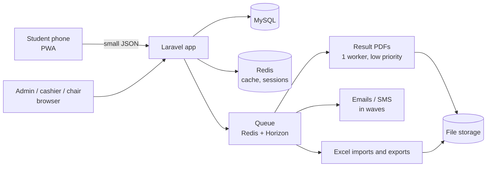

# Tech plan

What SKSU TPT v4 is built with, and why. It follows euphoria's stack (already running in production, so the team knows it) and every decision in the mockups. Items marked **Decide** need your answer.

## 1. The stack

| Part | Choice | Why |
|---|---|---|
| Backend | **Laravel 12**, PHP 8.4 | Same as euphoria; the TPT server already runs PHP 8.4 |
| Database | **MySQL 8** | Already on the server; tptv3 data can be read for reference |
| Screens | **Inertia 2 + Vue 3 + TypeScript** | Pages load once, then only small JSON moves (fast on phones) |
| Components | **Nuxt UI 4 + Tailwind 4** | euphoria's library: date pickers, tables, dialogs, drawers that look and behave the same everywhere |
| Student app | **PWA** (installable web app) | Install from the website on Android and iPhone; no APK, no store; offline permit |
| Sign-in | **Google** (Laravel Socialite) | Same as tptv3; staff by invite only |
| Roles | spatie/laravel-permission | Admin (+ super admin), Cashier, Proctor, Program chair / Dean |
| Lists, filters, sorting | spatie/laravel-query-builder | One pattern for every list (tabs, search, filters, sort, 25 per page) |
| Files (photos, receipts) | spatie/laravel-medialibrary | Photos shrunk on the phone first (about 200 KB) |
| Excel import and export | A streaming reader/writer (e.g. OpenSpout) | Reads the Testing Center file as it is; big exports run in the background |
| Result PDFs | **barryvdh/laravel-dompdf** | Light engine (no hidden browser); built before release by the queue |
| Cache, sessions, queue | **Redis** | Takes load off MySQL on peak days; runs the PDF and message queues |
| Queue monitor | Laravel Horizon | See jobs (PDFs, emails, imports), retry failed ones |
| Email | SMTP from the university address, or a mail service | **Decide** (official sender) |
| SMS | A Philippine SMS provider (e.g. Semaphore) | **Decide** (provider and budget); can start with email + in-app only |

## 2. How it fits together

## 3. Built for the peak days

- **Registration opening and results day** are the two busy moments (thousands at once).
- Lists and the student's own data are cached; pages send small JSON, not whole pages.
- Result PDFs are prepared **before** release; at release the server only hands out ready files.
- Notices go out **in waves**; heavy work (imports, exports, PDFs, messages) runs in the queue.
- Every action is rate-limited per student; support has its own limits.
- **Load test** with 10,000 simulated students (k6) on a copy of the server before going live.

## 4. Server

| | Plan |
|---|---|
| Where | A **new Ubuntu 24.04 droplet** (the current one is Ubuntu 20.04, out of standard support). tptv3 keeps running until the switch |
| Size | 2 cores / 8 GB for normal days; **4 cores on results day and registration opening** (resize, then back) |
| Web | nginx + PHP-FPM; queue workers under Supervisor |
| Deploy | From GitHub, same way as euphoria |
| Backups | Daily database + files, kept off the server; restore tested |
| Monitoring | Uptime check, error alerts, System status page in the admin |
| Security | HTTPS, firewall, SSH keys only, separate users; fix the old server's /root ownership before anything else runs there |

## 5. Build order

| Phase | What | Result |
|---|---|---|
| 1. Foundation | Project, sign-in, roles, school years, schedules, campuses, programs, rooms, exam slots | Admin can set up a school year |
| 2. Apply | Student PWA: sign in, apply, photo, review, Home by status, support tickets | Students can apply |
| 3. Pay | Cashier counter, OR checks, shifts, slip, examinee numbers | Payments recorded, numbers issued |
| 4. Exam | Pick exam slot, permit (tptv3 layout, QR, offline), optional check-in | Permits out |
| 5. Results | Excel import, approve, prepare PDFs (queue), release plan, survey, choose program | Results released safely |
| 6. Reports and polish | Reports, office summary, maintenance, privacy, load test, go-live | Ready for the real school year |

Each phase ends with a working, tested part, shown to you before the next starts.

## 6. To decide

1. **Server:** new droplet now for a test copy, or later? (Recommended: a small test copy now, the full one before go-live.)
2. **Email sender:** the university address (admission@sksu.edu.ph?) and who sets up its mail access.
3. **SMS:** start without SMS (email + in-app), or pick a provider and budget now?
4. **Timeline:** when is the next school year's registration? That sets the go-live date.
5. **Old data:** start fresh, or bring in tptv3's past applicants for reference only (read-only archive)?
